# Fixy — marketplace de servicios y oficios

**Una contratación trazable, desde la necesidad del cliente hasta la valoración del profesional.**

Fixy conecta a personas que necesitan resolver un problema con profesionales de oficios. El desafío del proyecto no se limita a publicar anuncios: consiste en coordinar selección, negociación, presupuesto, acuerdo, pago, ejecución, protección y reputación sin perder integridad entre esos pasos.

**[Probar la demo interactiva](https://youngnicojava.github.io/fixy-demo-frontend/) · [Código de la demo](https://github.com/youngnicoJava/fixy-demo-frontend) · [Documentación técnica](docs/README.md)**

> Este repositorio publica documentación y evidencia visual. El código principal de Fixy —frontend conectado, backend y Payment— se mantiene privado. La demo pública es una aplicación independiente, con datos ficticios y operaciones locales: no conecta al backend ni cobra dinero. El sistema privado continúa en desarrollo; los estados financieros implementados no equivalen a una integración de liquidaciones productiva terminada.

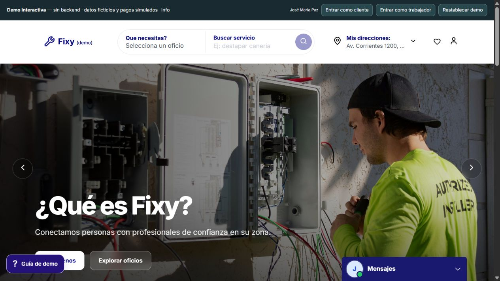

*Captura del frontend público, tomada en navegador el 10 de octubre de 2026. Las capturas de este repositorio corresponden a la demo, no a una plataforma productiva.*

## Recorrido visual ampliado

**[Ver las 27 capturas comentadas](docs/09-visual-tour.md) · [Seguir la demo paso a paso](docs/11-demo-walkthrough.md)**

La galería incluye login y registro, navbar con menús desplegados, modal de direcciones, dashboards cliente/profesional, detalle de publicación y una solicitud nueva desde publicación hasta trabajo en progreso. Presupuesto, acuerdo y pago simulado se muestran como etapas distintas. Completion y review están ilustradas con un fixture identificado, no como una transición nueva certificada.

Ver modal de direcciones y navegación de cuenta

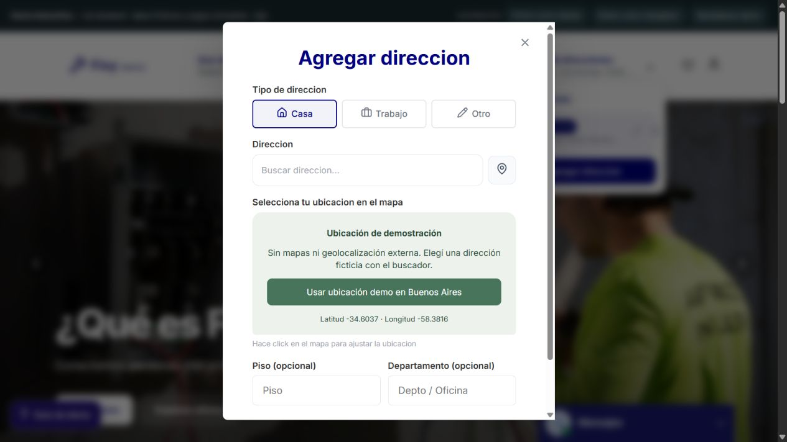

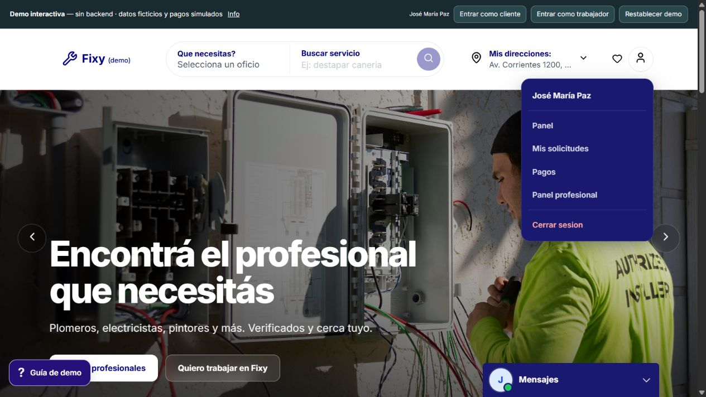

Ver dashboard cliente y detalle del servicio publicado

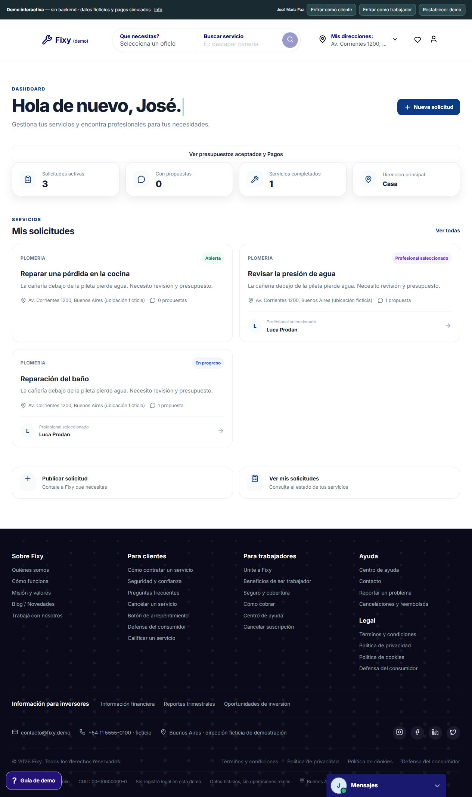

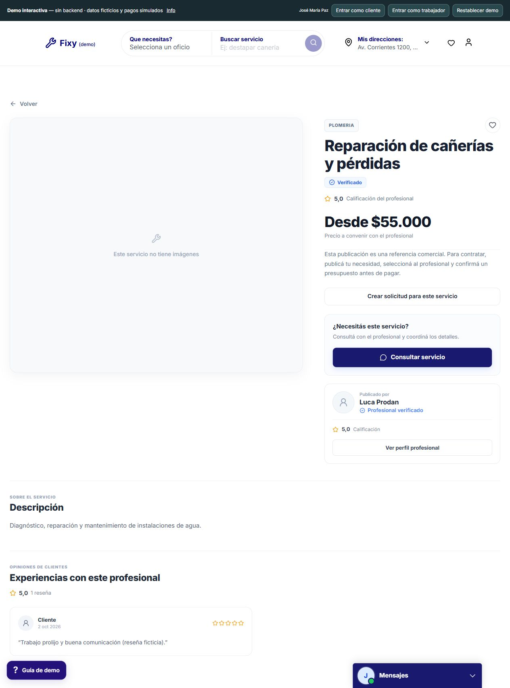

## Contenido

- [El problema que resuelve](#el-problema-que-resuelve)
- [Los tres proyectos](#los-tres-proyectos)
- [Arquitectura](#arquitectura)
- [Roles y responsabilidades](#roles-y-responsabilidades)
- [Flujo principal de contratación](#flujo-principal-de-contratación)
- [Modelo de dominio](#modelo-de-dominio)
- [Backend: reglas e integridad](#backend-reglas-e-integridad)
- [Autenticación y seguridad](#autenticación-y-seguridad)
- [Payment, Mercado Pago y Kafka](#payment-mercado-pago-y-kafka)
- [Conversaciones y reputación](#conversaciones-y-reputación)
- [Frontend y demo](#frontend-y-demo)
- [Validación y estado del proyecto](#validación-y-estado-del-proyecto)
- [Documentación ampliada](#documentación-ampliada)
- [Alcance público y licencia](#alcance-público-y-licencia)

## El problema que resuelve

Contratar un oficio normalmente mezcla conversaciones, presupuestos informales y pagos difíciles de relacionar con el trabajo acordado. Fixy separa esos conceptos y los conecta mediante entidades persistidas.

El cliente publica una necesidad. Un profesional habilitado propone una solución; puede necesitar inspeccionar el lugar antes de cotizar. El presupuesto define importes y alcance; su aceptación registra un acuerdo. Ese acuerdo determina qué se paga. El chat acompaña la coordinación, pero no es el contrato ni se analiza su texto para calcular precios.

El objetivo de producto es que ambas partes puedan responder: **qué trabajo acordaron, quién lo hará, cuánto cuesta, si el pago fue confirmado, qué protección está vigente y cuál es el próximo paso**.

## Los tres proyectos

| Proyecto | Responsabilidad | Stack observado en el código |
|---|---|---|
| **Fixy Frontend** | Experiencia de clientes, profesionales y administración; contratación, chat, pagos y perfiles | Angular 22, TypeScript 6, componentes standalone, Signals/computed, RxJS, SCSS, Angular Material/CDK, Vitest |
| **Fixy Backend** | Identidad, autorización, reglas de negocio, persistencia, contratos, estado financiero local y eventos | Java 21, Spring Boot 3.3.2, módulos Kotlin 2.0.21, Spring Security, JPA/Hibernate, PostgreSQL, JJWT, Spring Kafka |
| **Fixy Payment Service** | Adaptador externo de Mercado Pago: Checkout Pro, consultas al proveedor, recepción de webhooks y transporte de eventos | Go 1.23 declarado en el módulo, Chi, net/http, kafka-go, godotenv |

Estas versiones describen los manifiestos inspeccionados el **10/10/2026**. No se sustituyeron por versiones de conversaciones o documentos anteriores. El backend Kotlin forma parte de la misma aplicación Spring: el servicio separado de Payment es el proyecto Go.

La **demo pública** es una distribución separada del frontend, con un motor local que implementa un subconjunto de los contratos y reglas para mostrar el producto sin exponer los servicios privados.

## Arquitectura

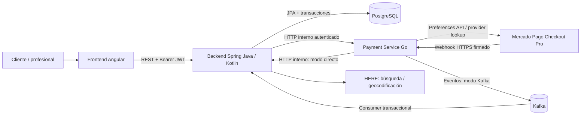

**La frontera importante:** Spring decide si una contratación puede cambiar de estado y conserva la verdad local en PostgreSQL. Go encapsula el contrato con Mercado Pago. El navegador no elige el importe financiero ni convierte una URL de retorno en confirmación de pago.

La integración combina comunicación síncrona y asíncrona: creación de checkout e inspección/reconciliación usan HTTP; las confirmaciones financieras pueden volver por HTTP interno o Kafka según configuración. Kafka no reemplaza todos los endpoints internos.

El backend es una aplicación modular organizada por funcionalidades; no se presenta como un conjunto de microservicios para cada entidad ni como una arquitectura hexagonal completa que el código no implementa.

## Roles y responsabilidades

| Actor | Acciones principales | Condiciones relevantes |
|---|---|---|
| **CLIENT** | Publicar solicitud, seleccionar propuesta, aceptar/rechazar presupuesto, pagar, confirmar finalización, crear review | Ownership de la solicitud y estado compatible |
| **WORKER** | Ofrecer servicios, proponer, emitir presupuesto, coordinar visita, iniciar trabajo | Perfil `VERIFIED`, categoría habilitada y selección cuando la operación lo exige |
| **ADMIN** | Revisar profesionales, aprobar/rechazar/suspender, destacar publicaciones; servicios de resolución de disputes | Endpoints administrativos existentes y autorización; no implica que toda capacidad tenga UI/API pública completa |
| **Servicio interno** | Solicitar checkout, inspeccionar proveedor y transportar eventos | Secreto interno compartido o infraestructura Kafka confiable; no es un usuario final |

El enum conserva además `USER`; el registro actual crea `CLIENT`. La aprobación profesional promueve el usuario a `WORKER`. Rol de usuario, perfil profesional y estado de verificación son conceptos distintos: tener una etiqueta de rol no reemplaza los controles de dominio.

La navegación/guards ayudan a la UX. La autorización decisiva ocurre en el servidor, incluyendo identidad de participantes, ownership y relación entre request, propuesta, presupuesto y acuerdo.

## Flujo principal de contratación

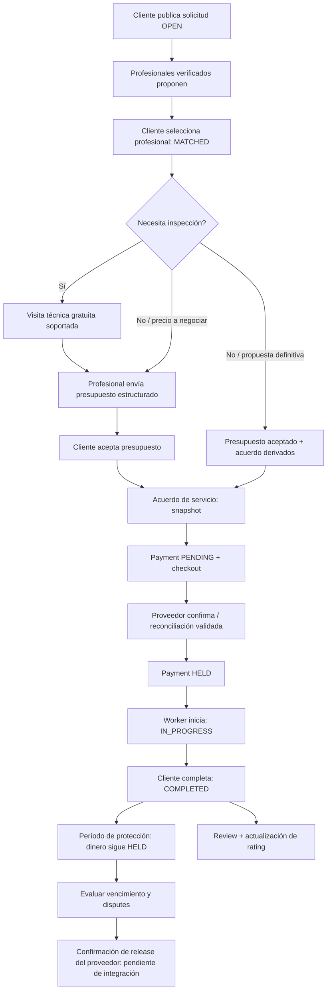

### Precio definitivo

Una propuesta `FIXED`, con total positivo y sin visita requerida, permite que la selección produzca presupuesto aceptado y acuerdo en el mismo flujo. El cliente no necesita volver a aceptar exactamente la misma información.

### Precio a evaluar

Seleccionar profesional no equivale a aceptar un importe final. Con el request `MATCHED`, ambos coordinan por chat; el worker envía un presupuesto con **mano de obra, materiales, total y alcance**. El cliente acepta o rechaza ese recurso. Una nueva revisión reemplaza presupuestos enviados anteriores; un acuerdo aceptado no se modifica silenciosamente.

### Visita técnica

El modelo expresa `REQUIRED → SCHEDULED → COMPLETED`, precio, notas y fechas. La visita gratuita puede completarse cuando llegó su fecha, y después permite cotizar. La visita paga está representada, pero su finalización se bloquea: requiere un pago diagnóstico independiente todavía no implementado. No se mezcla con el pago del trabajo.

### Pago, trabajo y protección

El pago nace del acuerdo aceptado. Confirmarlo produce `HELD` en el dominio de Fixy. El worker seleccionado puede iniciar; el cliente propietario confirma finalización. El trabajo queda `COMPLETED` mientras el pago sigue `HELD` y comienza el período de protección.

El default de protección es `P3D`, configurable y copiado al acuerdo/pago. La política recibe categoría como punto de extensión, pero actualmente no inventa duraciones distintas por oficio. La review puede publicarse al completar el trabajo, sin esperar una liquidación.

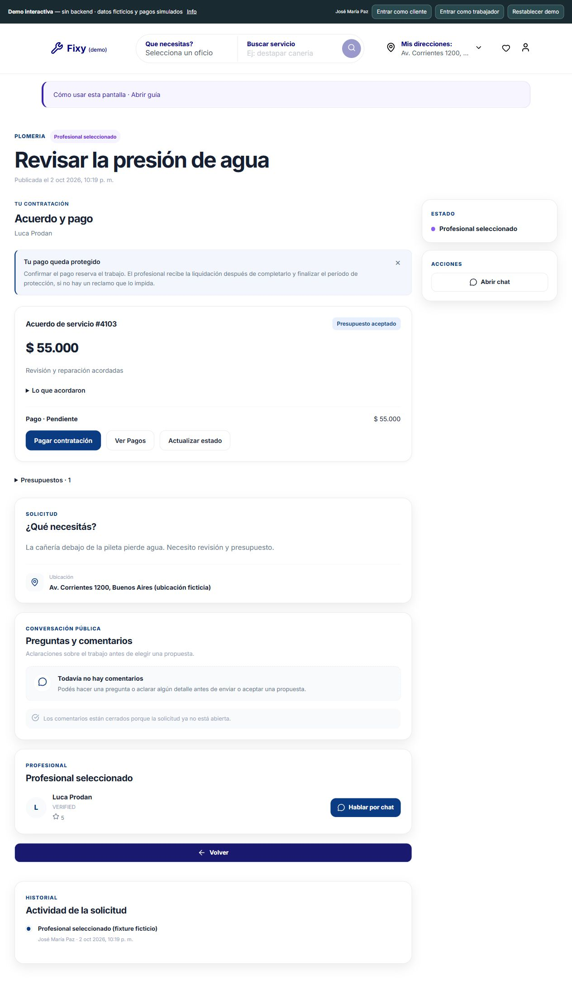

## Modelo de dominio

| Concepto | Qué representa | Qué no debe confundirse con él |
|---|---|---|
| `ServiceRequest` | Necesidad publicada y lifecycle del trabajo | Anuncio del profesional |
| `WorkerServiceOffering` | Publicación comercial del worker | Contratación ni pago |
| `WorkerProposal` | Postulación a una solicitud | Acuerdo financiero definitivo en todos los casos |
| `ServiceQuote` | Presupuesto estructurado, versionado y decidible | Mensaje libre de chat |
| `ServiceAgreement` | Snapshot del presupuesto aceptado y participantes | Factura fiscal |
| `ServiceVisit` | Diagnóstico previo a cotizar | Timer ni cobro por horas |
| `Payment` | Operación financiera local vinculada al acuerdo | Preference ni provider payment de Mercado Pago |
| `Conversation` / `Message` | Coordinación entre dos participantes | Fuente de verdad del precio |
| `Dispute` / evidencia | Reclamo y resolución persistida | Reembolso automático |
| `Review` | Valoración de una contratación completada | Opinión anónima sobre cualquier anuncio |
| `ServiceRequestEvent` | Timeline del negocio | Event store ni garantía de event sourcing |
| `WorkerEarning` / `Payout` | Modelos de ganancias y retiro | Transferencia productiva validada al worker |

**Identidades financieras separadas:** ID de Payment en Fixy, ID de preference de Checkout y ID del pago del proveedor cumplen funciones diferentes. `external_reference` correlaciona con el ID interno de Payment.

Los enums históricos `FIXED`, `NEGOTIABLE` y `HOURLY` se conservan por compatibilidad. `HOURLY` no implementa cronómetro, facturación por minuto ni pago automático por duración; la contratación requiere un importe acordado.

## Backend: reglas e integridad

El backend concentra los puntos que una UI por sí sola no puede proteger:

- Sólo un worker verificado y habilitado para la categoría puede proponer; no puede postularse a su propio pedido ni duplicar una propuesta por request.
- La selección verifica ownership, request abierto/no expirado, propuesta perteneciente al request y estado disponible. Rechaza las propuestas competidoras pendientes y crea la conversación asociada.
- Sólo el profesional seleccionado puede cotizar; sólo el cliente propietario puede decidir. Presupuesto, worker y request deben corresponder a la misma contratación.
- Importes y alcance del acuerdo son inmutables en el modelo persistido. No hay edición de un acuerdo aceptado ni adendas económicas implementadas todavía.
- Crear Payment exige acuerdo aceptado, profesional correspondiente y verificación vigente. El importe sale del acuerdo; la request del navegador identifica la contratación.
- Confirmación financiera valida identidad del proveedor e importe. Las transiciones inválidas, duplicadas conflictivas o ambiguas se rechazan.
- Inicio y completion requieren fondos confirmados `HELD`; `COMPLETED` no libera dinero.
- Una dispute activa bloquea settlement; una review requiere contratación completada, ownership, rating válido y ausencia de otra review.

### Transacciones, locks e idempotencia

`ServiceRequest` funciona como punto de serialización de las operaciones críticas. Los repositorios ofrecen lecturas con **pessimistic write lock**; Payment usa además bloqueo de su propia fila y refresca entidades antes de decidir.

La creación de checkout reserva primero una operación local duradera. La llamada de red al proveedor ocurre fuera de esa transacción; posteriormente se vincula la respuesta bajo locks. Un timeout no se interpreta como “el proveedor no creó nada”: conserva la identidad para inspección/recuperación.

El esquema declara unicidad para combinaciones y referencias críticas, incluyendo worker/request, request/revisión de quote, agreement/request, conversación/request, conversación/offering+client, review/request e identificadores financieros del proveedor. **Anotaciones JPA no demuestran por sí solas que toda instancia histórica de PostgreSQL tenga el esquema actualizado.**

La idempotencia de dominio evita repetir eventos/ganancias cuando llega nuevamente el mismo estado confirmado. No se promete atomicidad distribuida, exactly-once ni outbox transaccional inexistente.

## Autenticación y seguridad

Registro/login devuelven access JWT, refresh token y DTO de usuario. El JWT está firmado; su expiración es configurable. El refresh es un token opaco persistido, con vencimiento actual de siete días y rotación bajo transacción/lock. Un nuevo login conserva la política de una sesión de refresh por usuario.

El frontend centraliza el refresh en un **single-flight** compartido: varias requests con `401` esperan una sola renovación. Reemplaza ambos tokens y reintenta la request una vez. Un `401` tardío de un token anterior puede reutilizar las credenciales ya renovadas. Auth/refresh no entra recursivamente en el interceptor, y errores distintos de `401` no desencadenan renovaciones arbitrarias.

El acceso a storage se restringe al navegador. La implementación conectada actual conserva tokens en `localStorage`; no debe describirse como sesión con cookies HttpOnly ni autenticación SSR transparente.

En Spring existen rate limiting con Bucket4j en memoria, filtro de secreto interno, filtro JWT, seguridad stateless y controles de método/servicio. CORS admite orígenes explícitos configurables; no usa comodín con credenciales. El rate limiter actual es por instancia, no distribuido.

Detalles y limitaciones: [seguridad y sesión](docs/04-security-and-auth.md).

## Payment, Mercado Pago y Kafka

La integración inspeccionada utiliza **Checkout Pro con Preferences API**. No se migró a Orders API. Go crea/recupera una preference; el usuario paga en Mercado Pago; la confirmación se verifica mediante provider lookup y luego se aplica la máquina de estados local.

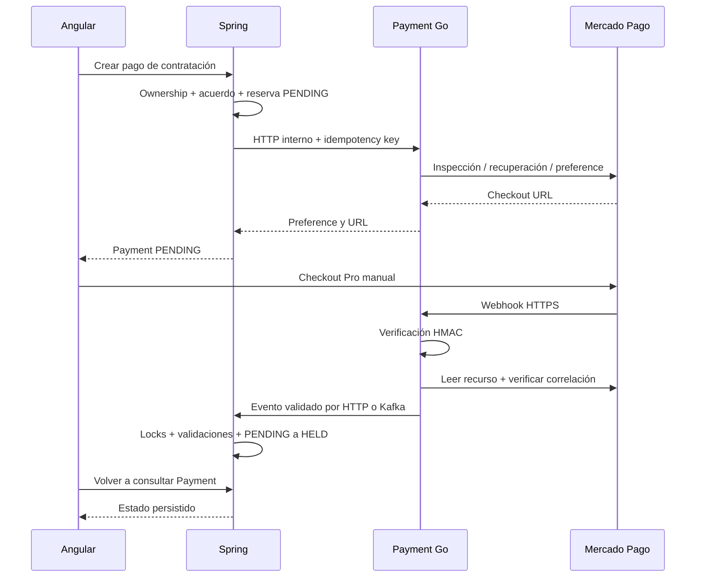

### Recuperación de un webhook perdido

Existe reconciliación autenticada y sincronización de estado. Go consulta el proveedor, valida collector, referencia interna, importe ARS, preference y merchant order; inspecciona pagos asociados para no elegir arbitrariamente entre aprobaciones duplicadas. Spring vuelve a validar ownership y snapshot bajo locks, y aplica la misma transición idempotente a `HELD`.

La recuperación no fabrica headers, no simula notificaciones ni modifica la DB manualmente. **Múltiples pagos aprobados o evidencia ambigua producen `409 MULTIPLE_PROVIDER_PAYMENTS`, sin crear ganancias.**

### Qué significa `HELD`

`HELD` es un estado del dominio financiero de Fixy. No acredita por sí solo escrow bancario, Split ni retención legal/productiva del proveedor. Completion inicia la protección; vencimiento habilita evaluar release. Actualmente Go responde `501` a la liberación porque la integración de settlement no está implementada. Los modelos de ganancias/retiro no deben confundirse con payouts reales ya validados.

### Kafka

Con Kafka habilitado, Go publica `payment.status-confirmed` en un envelope versionado; usa Payment ID como key, identificador determinista de evento y confirmación síncrona del broker. Spring consume, valida y procesa transaccionalmente, con retries y DLT. Sin Kafka usa el callback HTTP interno.

Esta infraestructura está implementada, pero la evidencia E2E existente no demuestra por sí sola un Golden Path completo sobre un broker real ni un webhook real firmado exitoso. [Detalle financiero y transporte](docs/05-payment-and-events.md).

## Conversaciones y reputación

El chat tiene dos contextos: una contratación con `ServiceRequest`, o contacto desde una `WorkerServiceOffering`. El segundo no crea un Payment automáticamente. Existen restricciones de participantes, unicidad y estados `OPEN/CLOSED`; la reapertura actual de conversación está vinculada a dispute de una solicitud.

El backend entrega `counterpart` en los DTOs de conversación: para el cliente es el worker, para el worker es el cliente. Lista, widget y header usan esa identidad; el sender del último mensaje no determina con quién se conversa. El frontend actual usa HTTP para cargar/enviar mensajes, no un chat WebSocket de tiempo real.

La review pertenece a una contratación completada. El cliente no elige otro worker en el body: se obtiene de la propuesta seleccionada. El promedio se calcula desde las reviews persistidas y se actualiza en el perfil profesional.

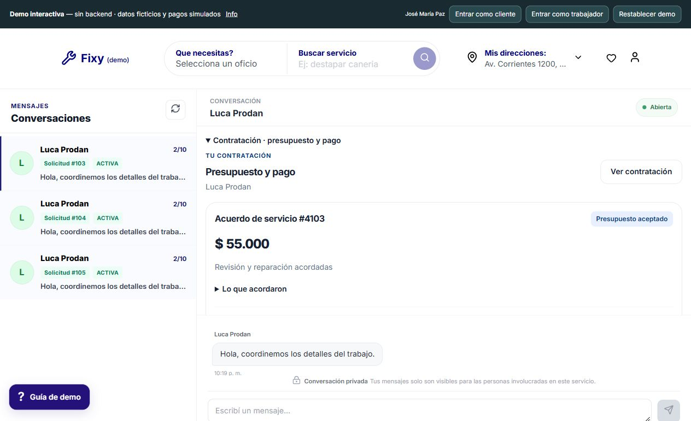

## Frontend y demo

El frontend organiza funcionalidades mediante rutas lazy y componentes standalone. Usa Signals/computed para estado y derivación, RxJS para HTTP y coordinación asíncrona, y componentes con OnPush donde se declara. `RequestDetail` concentra contratación, presupuesto, pago, chat, timeline y aftercare; `ContractPanel` reutiliza el contexto comercial. `/payments` agrupa contrataciones independientes por estado, sin carrito multi-request.

**Precisión del runtime:** el `app.config` inspeccionado usa `provideZoneChangeDetection()` y el build incluye `zone.js`; no es correcto afirmar que hoy toda la aplicación es zoneless. Hay infraestructura de servidor Angular, pero `app.routes.server` configura `RenderMode.Client` para todas las rutas. Tampoco se presenta como SSR/hydration completa validada.

La demo agrega motor local, fixtures, cambio de rol, persistencia versionada y guías contextuales. El interceptor demo responde localmente y bloquea el fallback HTTP al backend. Su despliegue real es **GitHub Pages mediante GitHub Actions**, con build estático y rutas hash; no requiere PostgreSQL, Go ni secretos.

### Probar el producto

1. Abrir la [demo](https://youngnicojava.github.io/fixy-demo-frontend/).
2. Usar **Entrar como cliente** o **Entrar como trabajador**; todos los nombres y ubicaciones de los fixtures son ficticios.
3. Consultar **Info** y la guía de cada pantalla.
4. Recorrer solicitud → propuesta → selección → presupuesto → aceptación → pago **simulado** → inicio → completion → review.
5. Recargar para comprobar persistencia local. Usar **Restablecer demo** para volver al escenario inicial.

No ingresar datos personales reales. Los pagos de la demo no abren Mercado Pago ni mueven dinero. Un fixture que muestra “finalizado” no demuestra una liquidación real.

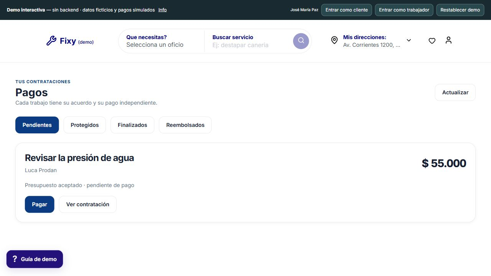

## Validación y estado del proyecto

| Capacidad | Estado documentado |
|---|---|
| Dominio de solicitudes/propuestas/contratos | Implementado, con tests de regresión |
| Checkout Pro TEST con pago aprobado real | Evidencia histórica PASS |
| Reconciliación autenticada y Payment HELD | Evidencia histórica PASS |
| Inicio, completion conservando HELD, review y rating | Evidencia histórica PASS |
| Prevención de reintentos peligrosos / múltiples aprobaciones | Implementada, con caso negativo y tests |
| Webhook real firmado procesado de punta a punta | **Pendiente; no PASS** |
| Simulación oficial de webhook | Diagnóstico separado; no reemplaza E2E real |
| Kafka producer/consumer/retries/DLT | Código y tests; validación integral de infraestructura pendiente |
| Settlement/release real, Split y payouts | **No terminados / no validados** |
| Visita gratuita | Soportada; visita paga necesita flujo independiente |
| Seña + saldo / milestones | No implementados |
| Demo pública | Disponible, independiente y simulada |

La suite incluye tests de autenticación/rotación concurrente, ownership, propuestas, contratos, Payment, protección, disputes, reviews, interlocutor de chat y Kafka. La demo registra una ejecución de **56 tests en 12 archivos** en su última validación guardada; ese número no es coverage del backend ni una ejecución de toda la plataforma.

Esta publicación de documentación no ejecuta pagos ni altera los fixtures privados. La distinción entre código inspeccionado, evidencia histórica y comprobación visual actual está desarrollada en [testing y evidencia](docs/08-testing-and-evidence.md).

## Documentación ampliada

| Documento | Contenido |
|---|---|
| [Índice y ruta de lectura](docs/README.md) | Cómo recorrer la documentación |
| [Arquitectura de los tres proyectos](docs/01-architecture.md) | Límites, dependencias, despliegue y decisiones |
| [Dominio y flujos](docs/02-domain-and-lifecycle.md) | Entidades, roles, estados, contratación, visitas y aftercare |
| [Backend en profundidad](docs/03-backend-engineering.md) | Servicios, persistencia, transacciones, locks y decisiones técnicas |
| [Seguridad y autenticación](docs/04-security-and-auth.md) | JWT, refresh, single-flight, ownership, CORS y límites |
| [Payment e integración de eventos](docs/05-payment-and-events.md) | Checkout Pro, HMAC, reconciliación, duplicados, Kafka y protección |
| [Guía de API](docs/06-api-contracts.md) | Endpoints reales, roles, semántica y contratos representativos |
| [Frontend y demo](docs/07-frontend-and-demo.md) | Angular, UX, runtime, deploy y recorrido reproducible |
| [Testing y evidencia](docs/08-testing-and-evidence.md) | Tests existentes, alcance E2E y evidencia sanitizada |
| [Galería de capturas reales](docs/09-visual-tour.md) | Pantallas verificadas y qué demuestra cada una |
| [Decisiones y próximos pasos](docs/10-decisions-and-roadmap.md) | Tradeoffs actuales, límites y backlog |
| [Recorrido paso a paso de la demo](docs/11-demo-walkthrough.md) | Interacciones por rol y evidencia del ciclo de contratación |

## Alcance público y licencia

Este repositorio permite estudiar el diseño de Fixy sin distribuir el código privado. Diagramas, ejemplos de contrato y explicaciones describen la implementación inspeccionada; no son una promesa de infraestructura productiva, SLA ni certificación financiera/legal.

Se conserva la [licencia Apache-2.0 existente](LICENSE) de este repositorio. Esa licencia no concede acceso ni derechos sobre repositorios privados, marca Fixy o código que no está incluido aquí. La demo tiene repositorio y condiciones de distribución propios; que pueda visitarse o leerse no modifica el alcance del código principal.

**Autor:** [Axel Fecha — youngnicoJava](https://github.com/youngnicoJava). Última revisión técnica de esta documentación: **10 de octubre de 2026**.
