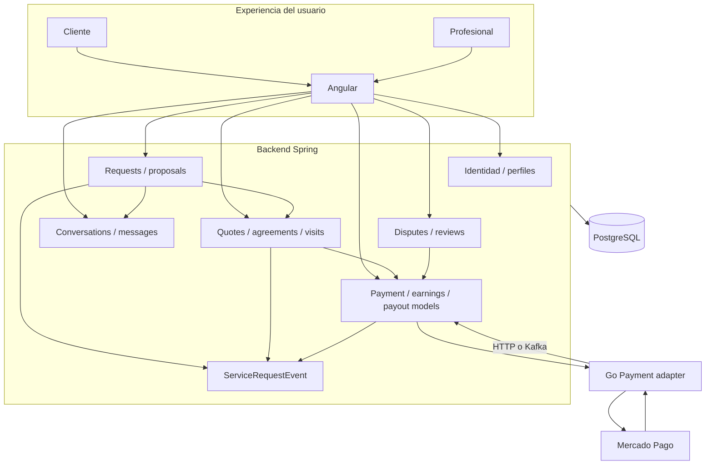
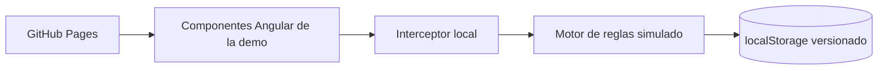

# 01 — Arquitectura de los tres proyectos

[Índice](README.md) · [Siguiente: dominio](02-domain-and-lifecycle.md)

## 1. Responsabilidades y ownership de datos

Fixy distribuye responsabilidades entre tres aplicaciones. La separación no significa tres fuentes equivalentes de verdad para cada entidad.

| Proceso | Posee / decide | Consume |
|---|---|---|
| Angular | Estado de presentación, navegación, formularios, sesión local, loading/error states | DTOs de Spring |
| Spring | Usuarios, perfiles, requests, proposals, quotes, agreements, visits, conversations, disputes, reviews y estado financiero local | PostgreSQL, adaptador Go, eventos financieros |
| Go Payment | Traducción hacia Mercado Pago, recepción firmada y consultas externas | Configuración del proveedor, solicitudes internas de Spring |
| Mercado Pago | Estado externo del cobro y recursos del proveedor | Preferences y checkout |

PostgreSQL pertenece al backend. El servicio Go inspeccionado no persiste un segundo ledger ni escribe directamente en las tablas de contratación: transmite resultados para que Spring los valide y aplique.

Esta decisión conserva juntas las invariantes de contratación y Payment local. Por ejemplo, una aprobación externa no puede crear `WorkerEarning` en Go sin pasar por las condiciones de release que conoce Spring.

## 2. Mapa de contexto

## 3. Backend Spring

Es una aplicación modular por funcionalidades. Controllers reciben contratos HTTP y principal autenticado; services orquestan reglas, transacciones y mappers; repositories expresan lecturas/escrituras JPA. Algunas entidades contienen comportamiento de dominio, como `matchWith`, `start`, `complete`, `decide` y `restoreAfterDispute`.

Java y Kotlin comparten el mismo runtime, configuración Spring, modelo JPA y base de datos. No existe un deployment Kotlin separado para el ledger. Los paquetes financieros y auth incluyen Kotlin; contracting, requests, messaging, reviews y disputes tienen implementación Java.

El stack declarado es Java 21, Spring Boot 3.3.2 y Kotlin 2.0.21. JJWT se utiliza para firma/lectura de JWT, BCrypt para passwords y Bucket4j para límites de requests. Springdoc publica OpenAPI para inspección local. Maven compila ambos lenguajes y configura plugins Kotlin de Spring/JPA/Lombok.

## 4. Servicio Go

El ejecutable monta un router Chi y handlers de preferencia, OAuth, inspección, reconciliación, webhook y operaciones financieras parciales. El cliente de Mercado Pago concentra HTTP externo; un `EventSink` permite cambiar el transporte de confirmaciones sin mover las reglas del backend.

| Dirección | Forma | Propósito |
|---|---|---|
| Spring → Go | HTTP interno | Crear/recuperar preference, inspeccionar y reconciliar |
| Mercado Pago → Go | POST público HTTPS | Notificar un recurso para validación y consulta |
| Go → Spring, modo directo | HTTP interno | Confirmar evento financiero validado |
| Go → Kafka → Spring | Evento versionado | Entregar la misma información mediante broker |

Los comandos de checkout continúan siendo HTTP aunque Kafka esté habilitado. No hay saga/orquestador distribuido general ni bus para todas las operaciones de Fixy.

## 5. Frontend conectado y demo pública

El frontend conectado usa servicios HTTP y DTOs para operar con Spring. El API URL procede de configuración de entorno de Angular. La comunicación con Go no se expone como cuatro checkouts diferentes en cada pantalla: RequestDetail, chat y Pagos reutilizan la contratación y el servicio financiero.

La demo es otra distribución con un interceptor que responde localmente. Su motor procesa contratos de API con datos ficticios, serializa cambios y persiste en storage. Sirve para enseñar el recorrido, no para demostrar disponibilidad o seguridad real del backend.

No hay Spring, Go, PostgreSQL ni Kafka detrás de la URL pública de la demo.

## 6. Red y configuración

Puertos habituales de desarrollo: Spring `8080`, Go `9090`, Angular conectado `4200`, demo local `4300`. Son convenciones de desarrollo, no direcciones productivas públicas. PostgreSQL se configura mediante `DB_URL`; no se documenta un puerto fijo como si cualquier contenedor local fuera la DB histórica.

Para Checkout Pro local se requieren dos orígenes HTTPS diferentes:

- Frontend público → Angular, usado para `FRONTEND_URL` y `/payments`.
- Payment público → Go, usado para `MP_WEBHOOK_URL` y `/webhooks/mercadopago`.

Túneles de desarrollo son infraestructura efímera. Un dominio configurado ayer no prueba que una entrega histórica llegó al servicio correcto. La validación requiere destino, hora y respuesta de entrega reales.

CORS del backend y allowlist del dev server Angular son controles distintos. Aceptar el hostname en Angular no autoriza automáticamente consumir Spring, ni CORS autentica una request.

## 7. Consistencia y fronteras de fallo

Una transacción PostgreSQL no cubre una llamada a Mercado Pago. La creación de Payment implementa reserva duradera y recuperación para el caso en que el proveedor respondió pero la respuesta no quedó guardada. El estado local puede quedar temporalmente `PENDING` mientras el proveedor ya aprobó; la reconciliación validada resuelve esa divergencia cuando la identidad no es ambigua.

Kafka permite reentrega y DLT, pero no hace exactamente una vez la mutación por sí mismo. La seguridad depende también de validación e idempotencia del consumer. El identificador determinista de evento no constituye por sí solo una tabla de deduplicación durable.

`ServiceRequestEvent` es un timeline persistido junto al negocio. Las entidades siguen siendo la fuente de estado; no se reconstruyen exclusivamente desde eventos. Por eso no se afirma event sourcing.

## 8. Dependencias externas y madurez

HERE ofrece búsqueda/geocodificación/reverse geocoding mediante endpoints del backend. El frontend conectado tiene dependencia Leaflet. La demo reemplaza estas operaciones por datos y controles locales para evitar claves y ubicaciones reales.

Mercado Pago Checkout Pro está integrado y tiene evidencia TEST real. La liberación al profesional, Split y payout productivo no están cerrados. La presencia de rutas/clases para OAuth y payout no convierte esos productos financieros en funcionalidades listas para producción.
