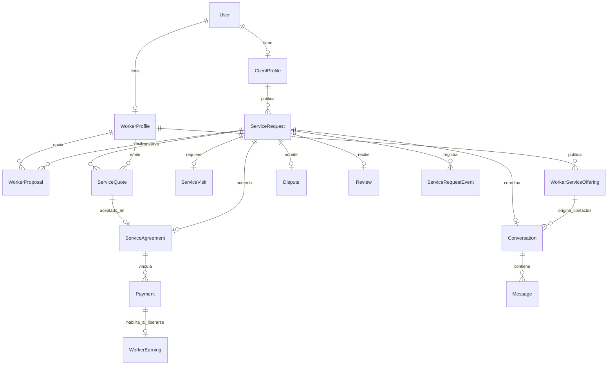
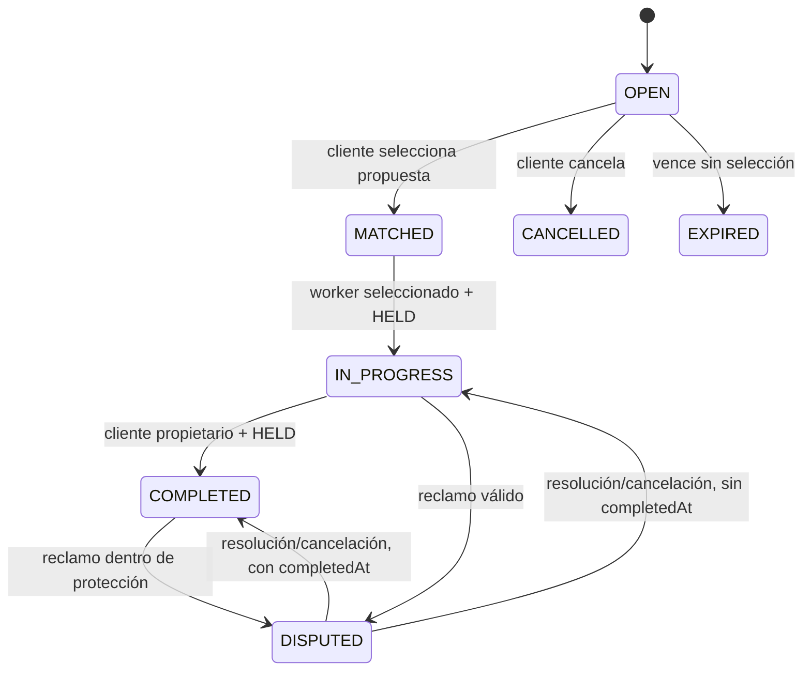
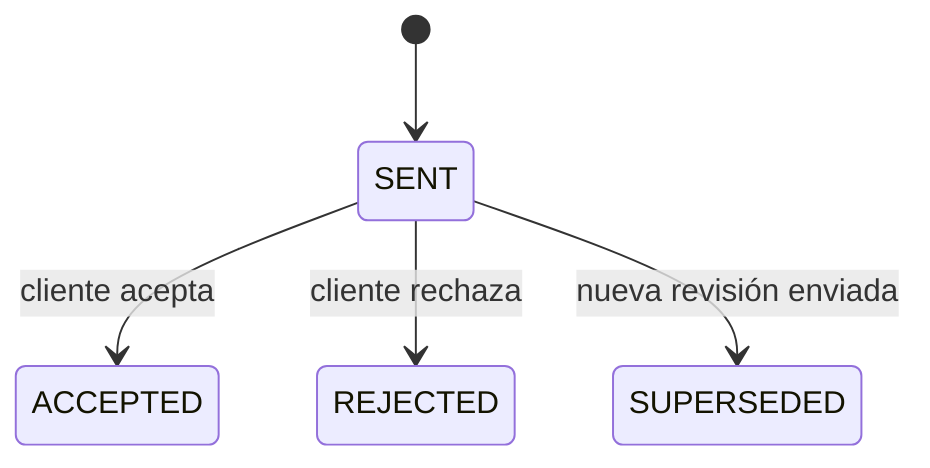
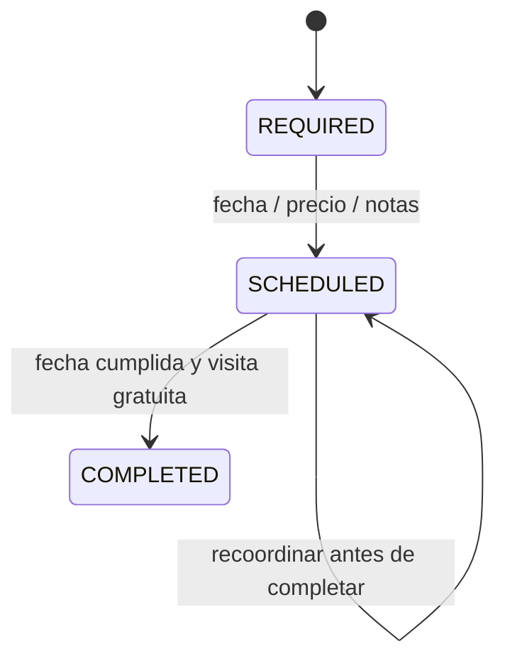

# 02 — Dominio, roles y lifecycle

[Índice](README.md) · [Backend](03-backend-engineering.md)

## 1. Dos entradas comerciales diferentes

**ServiceRequest** nace del cliente: “necesito solucionar esto”. Tiene categoría, descripción, ubicación, expiración, propuestas y estados del trabajo.

**WorkerServiceOffering** nace del profesional: “ofrezco este servicio”. Tiene contenido comercial, categoría, referencias de precio, estado activo y visibilidad. Contactar desde esa publicación inicia una conversación; no crea automáticamente acuerdo, contratación ni Payment.

Una tarifa “desde” o una referencia por hora no es un importe confirmado. La contratación termina requiriendo presupuesto/acuerdo concreto.

## 2. Identidad y habilitación

`User` conserva identidad y rol (`USER`, `CLIENT`, `WORKER`, `ADMIN`). `ClientProfile` representa al cliente y sus direcciones; `WorkerProfile` representa al profesional, categorías, información de perfil, rating y verificación.

Los estados profesionales son `PENDING`, `VERIFIED`, `REJECTED` y `SUSPENDED`. Registrar un usuario crea `CLIENT`; solicitar onboarding no equivale a quedar habilitado. La aprobación administra el perfil y promueve el rol a `WORKER`.

Las reglas de elegibilidad se revisan cuando se actúa, no sólo al listar oportunidades. La selección vuelve a comprobar verificación/categoría, y pagar vuelve a comprobar la verificación del profesional contratado.

## 3. Relación conceptual de entidades

Es un mapa conceptual, no un dump del esquema físico. Payment conserva compatibilidad con registros históricos sin agreement; las operaciones nuevas exigen acuerdo. La relación uno-a-muchos de pagos no habilita cuotas o milestones actuales: admite historial de intentos y evolución futura.

## 4. Solicitud y propuesta

La expiración por defecto de una solicitud es de 24 horas en el modelo inspeccionado. La validación impide seleccionar/proponer fuera de la ventana de una solicitud abierta. No se presenta un scheduler global de expiración como garantizado por el simple hecho de que exista `expiresAt`.

Una propuesta vincula un worker con un request. Conserva mensaje, estimación, modalidad histórica y `requiresVisit`. Sólo puede elegirse una pendiente que pertenezca al request; las competidoras pendientes se rechazan en la selección.

La cancelación normal actual es para `OPEN`. No se inventa una política de cancelación luego de contratar o pagar, ni se interpreta cancelar una solicitud como devolución automática.

## 5. Presupuesto estructurado

`ServiceQuote` incluye request, worker, cliente, revisión, mano de obra, materiales, total, scope, estado y fechas. Importes usan precisión decimal; el total positivo se deriva de los componentes. Hay unicidad por request/revisión.

Sólo se decide un `SENT`. No se vuelve a aceptar/rechazar una revisión ya decidida. Los términos no se sobrescriben: emitir una revisión crea otro recurso y reemplaza los enviados previos.

Antes de emitir/decidir se valida request con profesional seleccionado (`MATCHED`, o `IN_PROGRESS` para compatibilidad con contrataciones existentes). Si hay visita, debe estar completada. Si ya existe agreement, el servicio rechaza nuevos presupuestos: no hay renegociación posterior implementada.

### Propuesta definitiva

Seleccionar una propuesta `FIXED` sin visita deriva automáticamente quote por la estimación definitiva, materiales cero y scope tomado de la propuesta; registra aceptación y agreement. La estimación debe ser positiva. Si hay visita requerida, no se utiliza esta vía automática aunque el enum sea `FIXED`.

### Negociación

En otros casos, el cliente selecciona profesional pero todavía no confirma un precio. Se habilita coordinación y el worker debe enviar el presupuesto estructurado. El chat puede mostrar la tarjeta contextual del presupuesto; la decisión se ejecuta contra la API de contratación, no como un texto “acepto” sin efecto contractual.

## 6. Acuerdo como snapshot

`ServiceAgreement` vincula un request con un quote aceptado, cliente, worker, total, scope, fecha de aceptación y `protectionPeriodSeconds`. Las relaciones y términos se marcan no actualizables en JPA; el servicio impide reemplazo silencioso.

El acuerdo no tiene una máquina de estados independiente duplicada: el DTO muestra el estado operativo del request. Tampoco es factura fiscal. Una futura adenda debería modelar historial y reglas explícitas, no cambiar el importe por un PUT arbitrario.

## 7. Visita técnica

La representación permite indicar precio, pero una visita paga no puede completarse con el flujo actual. Requiere contratación/pago diagnóstico separado, reglas de devolución y posible descuento posterior aún pendientes. Este bloqueo evita que el precio de diagnóstico se mezcle silenciosamente con el trabajo final.

Una visita completada no se edita. Programarla requiere que no existan quotes ni agreement. No hay código de inicio, timer ni cálculo automático por hora.

## 8. Trabajo y dinero: dos lifecycles

| Momento | ServiceRequest | Payment esperado |
|---|---|---|
| Selección / negociación | MATCHED | Ausente o PENDING |
| Cobro confirmado | MATCHED | HELD |
| Trabajo iniciado | IN_PROGRESS | HELD |
| Cliente confirma finalización | COMPLETED | HELD |
| Protección activa | COMPLETED | HELD |
| Release confirmado bajo reglas | COMPLETED | RELEASED, integración externa pendiente |

El plazo de protección empieza en `completedAt`, no al abrir chat, aceptar presupuesto ni iniciar trabajo. El acuerdo captura la política vigente y Payment conserva ese plazo. El default es tres días, con configuración central `fixy.payment.protection-period`.

La elegibilidad para settlement exige trabajo completado, plazo vencido, fondos protegidos y ausencia de bloqueo de dispute. No significa que ya ocurrió una transferencia.

## 9. Disputes

Cliente o worker seleccionado pueden reclamar en `IN_PROGRESS` o `COMPLETED`, con Payment HELD. Si el trabajo ya terminó, la ventana de protección debe seguir abierta. Si ya se solicitó release, el sistema bloquea el reclamo normal y exige revisión/reconciliación; no abre una carrera entre liberar y reclamar.

Hay una dispute por request en el modelo actual, con evidencia asociada y resolución registrada. Abrirla mueve el request a `DISPUTED`. Cancelación/resolución/rechazo restauran el estado operativo según `completedAt`.

Cancelar el reclamo no borra la historia ni permite suponer que se puede crear otro libremente: la unicidad sigue aplicando. La resolución no dispara por sí misma refund/Split. El proceso financiero requiere reglas y confirmación propias.

## 10. Review y reputación

La review la crea el cliente propietario sobre un request `COMPLETED`. El worker viene de la propuesta seleccionada; hay una review por contratación, rating entero válido entre 1 y 5 y comentario persistido.

El promedio se obtiene de la base y actualiza `WorkerProfile`. No se permite que el cliente envíe un promedio arbitrario ni valore otro profesional en el body.

La review puede ocurrir mientras Payment siga HELD. No requiere payout, ni demuestra ausencia de reclamos futuros dentro de la protección.

## 11. Timeline

`ServiceRequestEvent` registra tipo, request, actor cuando corresponde, timestamp y descripción. La selección registra rechazo de competidoras, aceptación y match; contracting registra visitas/quotes; Payment registra confirmación y settlement; completion registra finalización y comienzo de protección; review agrega valoración.

El frontend representa estos hechos persistidos. El historial puede tener descripciones históricas en inglés y nuevas en español; el tipo de evento es más estable que analizar el texto descriptivo. No se deducen importes del timeline ni se usa como ledger independiente.
