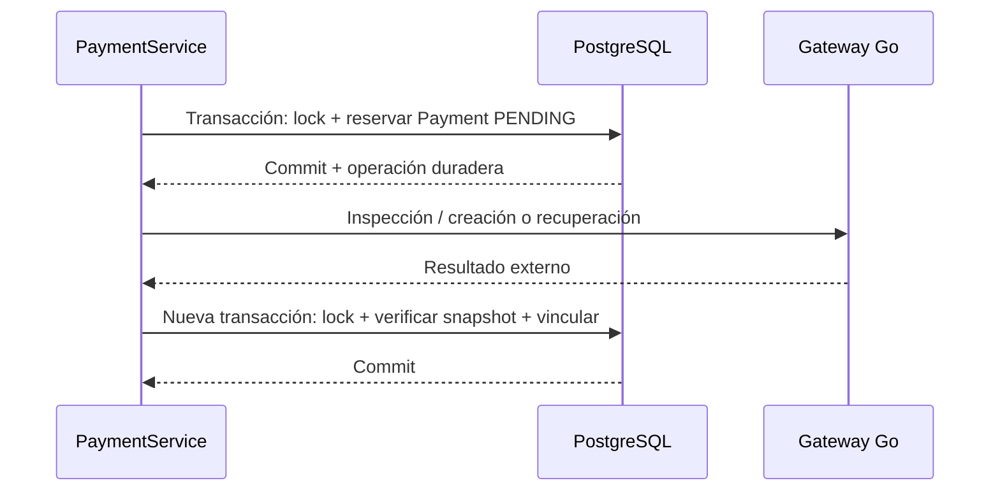

# 03 — Ingeniería del backend

[Índice](README.md) · [Seguridad](04-security-and-auth.md)

## 1. Organización y colaboración Java/Kotlin

El backend es una aplicación Spring con módulos funcionales. Java y Kotlin compilan dentro del mismo artefacto Maven. Los services comparten repositorios, entidades y contexto transaccional; la separación de lenguaje no crea una frontera de red.

| Área | Responsabilidades |
|---|---|
| auth / token / user | Registro, login, JWT, refresh opaco, usuario autenticado |
| client / worker | Perfiles, direcciones, categorías, onboarding y verificación |
| servicerequest | Solicitudes, propuestas, selección, inicio, completion y timeline |
| contracting | Quotes, agreements, visitas y política de protección |
| messaging | Dos contextos de conversación, participantes y mensajes |
| review | Elegibilidad, unicidad y cálculo de rating |
| dispute | Reclamos, evidencia, resolución y restauración del estado |
| payment | Operación financiera local, checkout, inspección, reconciliación y settlement |
| paymentAccount / workerearning / payout | Modelos para cuenta vinculada, ganancias y retiros, con integración externa parcial |
| config / filters | Seguridad, CORS, rate limiting, cliente HTTP y Kafka |
| location / image | Integraciones auxiliares de ubicación y carga de imágenes |

Los controllers extraen el principal y validan DTOs; los services verifican relaciones y estados antes de persistir. Las entidades contienen parte del comportamiento, pero no orquestan llamadas HTTP al proveedor.

## 2. ServiceRequest como centro del aggregate operativo

La solicitud contiene la selección y fechas de lifecycle. `matchWith` comprueba que la propuesta pertenezca a la solicitud, esté pendiente y el request esté abierto/no expirado. `start` y `complete` protegen el orden de estados.

El service agrega reglas externas al aggregate: identidad del actor, habilitación del worker, fondos HELD, rechazo de competidoras, creación de conversación, acuerdo derivado y eventos.

Es importante esa diferencia: llamar un método de entidad en un test no verifica todas las precondiciones de un endpoint. Los tests de integración/service deben cubrir también las relaciones y la condición financiera.

## 3. Selección atómica

La selección opera dentro de una transacción y toma lock sobre el request. Su orden lógico es:

1. Cargar cliente y solicitud con bloqueo.
2. Comprobar ownership, estado y vencimiento.
3. Validar propuesta/request, verificación actual y categoría.
4. Rechazar las competidoras pendientes.
5. Asignar propuesta seleccionada y timestamps.
6. Aceptar propuesta, crear conversación y registrar eventos.
7. Si corresponde, derivar quote/agreement definitivo o visita requerida.

Si una regla posterior falla, la transacción impide dejar sólo una parte del match confirmada. El precio definitivo no se copia desde el frontend en un segundo paso informal.

## 4. ContractService e inmutabilidad

Las operaciones de contracting comparten transacción y lock de request. `send`, `decide`, `scheduleVisit` y `completeVisit` aplican permisos por participante y estado.

`ServiceQuote` usa una revisión entera única por solicitud. Emitir un nuevo presupuesto crea un recurso y marca los enviados previos `SUPERSEDED`. `decide` sólo acepta/rechaza `SENT`; guarda `decidedAt`.

`ServiceAgreement` congela quote, request, partes, total, scope y política. Sus campos críticos son no actualizables en JPA y no hay endpoint de edición de términos. La combinación de API restringida, service y snapshot evita depender únicamente de un formulario deshabilitado.

Esto no convierte el registro en un documento legal firmado electrónicamente ni en un hash notarial. La auditabilidad actual proviene de entidades, fechas, decisiones y eventos persistidos.

## 5. Persistencia y constraints

El modelo utiliza PostgreSQL y JPA/Hibernate; IDs generados y relaciones entre perfiles/contrataciones. Los nuevos modelos de contracting usan relaciones lazy y decimales con precisión/escala explícitas.

| Invariante | Refuerzo declarado en el modelo |
|---|---|
| Email único | Columna única de User |
| Propuesta única worker/request | Constraint compuesto |
| Revisión única de presupuesto | `service_request_id + revision` |
| Agreement único por request / quote | Relaciones one-to-one con unicidad |
| Visita única por request | Relación one-to-one única |
| Conversación por request | Constraint único del contexto |
| Conversación por offering + client | Constraint compuesto |
| Review / dispute por request | Constraints de unicidad |
| Preference y provider payment no reutilizados | Constraints únicos en Payment |

Constraints son la última barrera de integridad; los services buscan devolver errores de negocio antes de llegar a una excepción SQL. Un check `exists` sin transacción/lock no sustituye la unicidad ante concurrencia.

La configuración revisada conserva `spring.jpa.hibernate.ddl-auto=update`. No hay una estrategia Flyway implementada que pueda documentarse como control de schema en producción. Base histórica, anotaciones y documentación deben contrastarse antes de desplegar.

## 6. Concurrencia y orden de locks

Las operaciones críticas obtienen `PESSIMISTIC_WRITE` por request. Payment, además, bloquea su fila antes de aplicar una transición. El flujo usa `flush`/`refresh` cuando necesita releer cambios después de esperar por un lock.

Esta técnica permite serializar dos intentos de selección, aceptación o creación financiera sobre la misma contratación. No elimina todos los riesgos de deadlock ni reemplaza constraints: requiere orden consistente y transacciones acotadas.

La rotación de refresh tiene su propio lock por token. Su propósito es distinto: impedir que el mismo refresh se consuma dos veces concurrentemente.

## 7. Red fuera de transacción en checkout

Payment usa `TransactionTemplate` para delimitar reserva y persistencia sin mantener abierto un lock mientras espera Mercado Pago:

La reserva tiene `checkoutRequestedAt`, y la precisión temporal se normaliza para comparar el intento que posee el lease. Ante un fallo conocido de configuración se libera la reserva del mismo intento; una respuesta tardía no debe limpiar la reserva de uno más nuevo. Ante timeout ambiguo se conserva la operación.

No se extrapola este patrón a todos los módulos: payout tiene código histórico con límites transaccionales y llamadas externas que requieren revisión antes de una integración productiva.

## 8. Representación monetaria

Spring utiliza `BigDecimal`, compara importes mediante `compareTo` y persiste con precisión/escala. La comisión actual es **9 %**, calculada con redondeo `HALF_UP` a dos decimales. Es una regla actual del código, no una tarifa comercial garantizada o una configuración por categoría ya disponible.

Go evita un round-trip float en el flujo de checkout/validación: conserva `json.Number` y utiliza `big.Rat` para comparar. El payout histórico conserva una representación distinta y no debe presentarse como un pipeline financiero uniformemente endurecido.

Nuevo Payment toma total y plazo del acuerdo. No acepta que el navegador decida `feeAmount`, estado financiero o neto del worker. Seña/saldo no están implementados.

## 9. Queries y performance

Hay repositorios especializados para ownership, conversaciones, último Payment, rating, settlement y locks. El scheduler consulta candidatos paginados; algunos listados tienen límites/top-rated. DTOs separan datos de presentación de las entidades persistidas.

No se afirma ausencia total de N+1. El mapper de conversaciones consulta último mensaje por conversación, y el listado de Pagos consulta pagos por acuerdos; bajo un volumen grande requieren profiling y queries agregadas/batch. Tampoco toda relación financiera es lazy.

La recomendación es medir queries por endpoint, plan de ejecución e índices antes de un refactor. Mapear entidades dentro de transacciones evita algunos fallos lazy, pero no corrige por sí mismo un exceso de consultas.

## 10. Eventos y trazabilidad

`ServiceRequestEvent` persiste hechos del negocio con actor opcional. Confirmaciones automáticas pueden no tener usuario final; reconciliación autenticada registra el cliente y una descripción que distingue el mecanismo.

El timeline no sustituye logs técnicos, historial de entregas del proveedor ni un ledger contable. Cada uno demuestra algo diferente. Los logs deben permitir seguir correlaciones sin almacenar tokens completos o datos innecesarios.

## 11. Aftercare opcional y errores

Review, dispute y Payment asociados pueden no existir para una contratación válida. Sus endpoints de consulta opcional verifican primero existencia del request y acceso, y luego representan ausencia con `204 No Content`.

Esto evita errores HTTP esperados durante una carga normal sin ocultar `401`, `403`, `404` de request inexistente ni errores del servidor. Los contratos nulos deben estar declarados en los servicios frontend.

Los errores del sistema no forman un `ProblemDetail` homogéneo en toda la aplicación: existen `ResponseStatusException`, respuestas de filtros y JSON del adaptador. Normalizar esa taxonomía es trabajo futuro; la documentación no inventa un envelope que todos los endpoints ya cumplan.

## 12. Lo que este diseño no promete

No hay transacciones ACID entre Spring, Kafka y Mercado Pago; no hay outbox/inbox durable general; no hay distribución completa de todos los módulos; no hay migraciones versionadas ya terminadas ni test de carga que demuestre capacidad productiva. Estas limitaciones se registran para que el contenido técnico no dependa de nombres de herramientas o comentarios optimistas del código.
