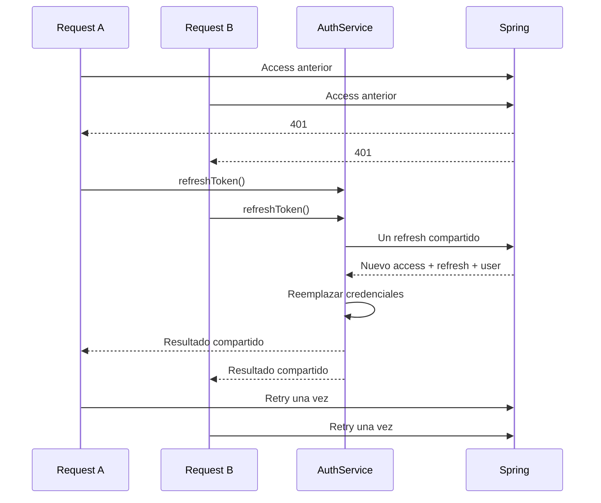

# 04 — Seguridad, identidad y renovación de sesión

[Índice](README.md) · [Payment](05-payment-and-events.md)

## 1. Credenciales y usuario

El registro actual valida coincidencia de passwords y email único, codifica password con BCrypt, crea User CLIENT y ClientProfile. Login valida password y devuelve el mismo contrato de autenticación: access token, refresh token y DTO de usuario.

El access es JWT firmado con JJWT. Incluye sujeto por email, rol, emisión y expiración. El período depende de `jwt.expiration`/`JWT_EXPIRATION`; el código interpreta el valor en milisegundos. No se publica aquí su valor local ni la clave de firma.

El usuario autenticado no se identifica por un clientId elegido en el body: el controller utiliza el principal de Spring Security y el service comprueba pertenencia.

## 2. Refresh: token opaco y rotación

El refresh actual es un UUID opaco persistido con usuario, expiry y flag de revocación. Tiene vencimiento de siete días por emisión. Un login borra los refresh previos del usuario, conservando la política de una sesión renovable.

La rotación consulta con lock, comprueba vencimiento/revocación, elimina el anterior y crea uno nuevo dentro de la misma transacción. El cliente recibe un nuevo access y un nuevo refresh; conservar el refresh anterior provoca que el siguiente intento sea inválido.

`POST /api/auth/refresh` espera el refresh en `Authorization: Bearer <refresh>`, no un DTO histórico de body. El access y el refresh no son intercambiables.

Este modelo no implementa familias de tokens/dispositivos ni detección de replay con revocación de toda la familia; la eliminación del token consumido y el lock protegen el uso actual. Tampoco guarda el refresh como hash irreversible.

## 3. Interceptor y single-flight Angular

La implementación adquiere el flight al suscribirse, guarda el observable en curso y usa `shareReplay` para compartir una respuesta. El finalize pertenece al HTTP source, no a cada waiter; desuscribir un consumidor no genera otro refresh mientras el original sigue en curso.

El interceptor sólo agrega credenciales al prefijo de API Fixy en navegador. Excluye auth y rutas internas; no filtra tokens hacia recursos externos. Ante un `401` de una request con token y sesión vigente, renueva/reutiliza credenciales y reintenta una vez. El segundo error se propaga.

Un `401` tardío puede corresponder al token que otro request ya reemplazó; en ese caso reintenta con el actual sin rotar otra vez. `sessionVersion` evita que una respuesta tardía de refresh restaure una sesión después de logout/cambio de usuario.

Errores `403`, `400` y `500` no significan automáticamente JWT vencido. Un fallo transitorio de refresh no elimina la sesión como si el token hubiera sido revocado; un `401` de refresh limpia storage, estado y redirige al login.

Hay también timer de renovación anticipada basado en `exp`; se evita un loop inmediato con tokens de vida muy corta. El timer se limpia en logout/destrucción.

## 4. Persistencia del navegador y SSR

`AuthService` usa `isPlatformBrowser` antes de leer `localStorage`, timers y APIs de navegador. Guarda access, refresh y usuario; actualiza Signal de usuario y observable conservado por compatibilidad.

El logout actual es local: limpia tokens y estado. No equivale a revocar instantáneamente todos los JWT ya emitidos en el servidor. El token expira según su TTL; no se documenta una denylist global inexistente.

Storage accesible a JavaScript implica riesgo ante XSS. El sistema no usa hoy refresh en cookie HttpOnly. Cambiar almacenamiento requiere diseñar CSRF, CORS, subdominios y SSR; no es una sustitución cosmética.

El código evita acceder al storage en servidor, pero eso no significa que el servidor pueda restaurar una sesión privada durante SSR. El runtime actual renderiza rutas en modo cliente.

## 5. Capas del backend

| Capa | Propósito | Límite actual |
|---|---|---|
| RateLimitFilter | Bucket4j por IP, respuesta 429 | In-memory por proceso |
| InternalSecretFilter | Validar secreto en rutas internas | Credencial compartida, no identidad de usuario |
| JwtFilter | Verificar access y establecer principal | No reemplaza ownership |
| Spring Security | Stateless, reglas de ruta y method security | Servicios deben validar relaciones |
| Services | Worker verificado, categoría, participantes, dueño, estado | Deben ejecutarse también frente a requests manuales |

El código registra filtros alrededor de la cadena de autenticación y declara órdenes para rate/internal. Se documenta la composición prevista; no se convierte una revisión de configuración en evidencia de tracing de todos los filtros en producción.

El rate limiter define capacidad general de 100/minuto y sensible de 10/minuto para ciertos prefijos de auth/perfiles/direcciones. Usa dirección remota de la request; no constituye protección distribuida ni una política de confianza de proxies ya resuelta.

CSRF está deshabilitado en la configuración stateless actual. Las APIs no autorizan a un usuario porque el frontend oculta un botón: ownership y participantes se comprueban en services.

## 6. Tráfico interno

Spring protege `/api/payments/internal/**` y `/api/payouts/internal/**` con `X-Internal-Secret`. Aunque esas rutas sean permitidas por la regla general de Spring Security, el filtro interno verifica el secreto; una llamada válida se reconoce explícitamente como interna para el flujo JWT.

Go protege `/internal/mp/**` con el mismo concepto. La comparación del secreto no imprime su valor. El navegador no debe recibirlo ni llamar esos endpoints directamente.

Esto no equivale a mTLS ni service mesh. Para producción se deben restringir red, transporte y rotación; Kafka exige sus propias ACL/TLS/SASL y no queda protegido por el header HTTP.

## 7. CORS

`CORS_ALLOWED_ORIGINS` se mapea a `fixy.cors.allowed-origins`, lista explícita separada por comas. El parser rechaza orígenes con paths, credenciales embebidas, query o fragmentos. Permite métodos REST usados y headers Authorization/Content-Type, con credentials habilitadas.

No se usa `*`. `http://localhost:4200` es el default de desarrollo, no una autorización automática para cualquier túnel. El frontend HTTPS de pruebas debe añadirse por entorno cuando corresponda.

## 8. Webhook: frontera distinta

El webhook de Mercado Pago es público, sin secreto interno. Su autenticidad se verifica con HMAC-SHA256 y la Secret Key de Webhooks; esa key no es el Access Token ni OAuth client secret.

El código actual exige `x-request-id`, `x-signature` parseable, `ts` positivo y `v1` hexadecimal. Construye el manifest con ID numérico y compara mediante `hmac.Equal`. Comprueba igualdad de ID entre body y query. Una firma inválida responde 401 y no debe cambiar un Payment.

No hay autorización por visitar `back_urls` ni por copiar `status=approved` del navegador. La información financiera se relee del proveedor, con credencial backend.

El verificador estricto actual y la interoperabilidad de headers deben seguir cubiertos por evidencia REAL; una simulación exitosa no explica retroactivamente una entrega 401 sin headers originales. No se recomienda quitar validaciones para lograr un PASS.

## 9. Logging y documentación pública

Se documentan nombres de variables y mecanismos; nunca sus valores efectivos. No se publican JWT, refresh, Access Token, client secret, Secret Key de webhook, firmas completas, credenciales de comprador ni dumps de usuarios.

Las capturas usan únicamente fixtures de la demo. Swagger debe capturarse sin ventana de autorización, headers de requests reales ni respuestas con datos personales. En esta publicación no se generó una captura de Swagger porque el backend local no respondió.
