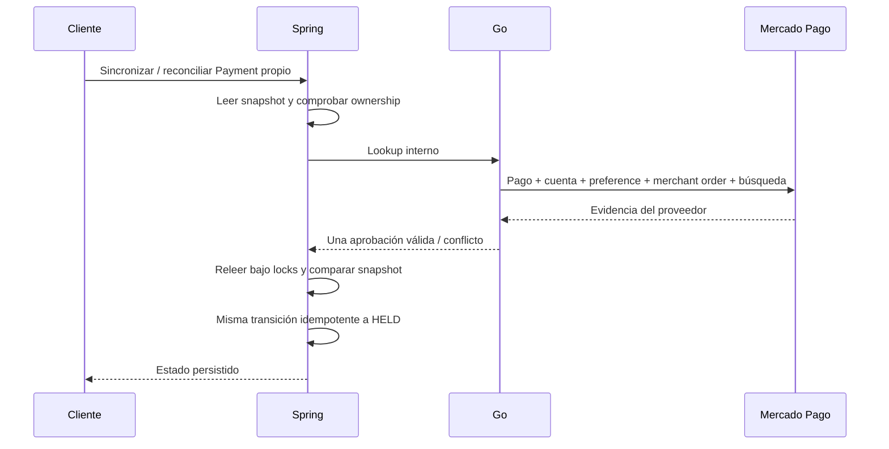
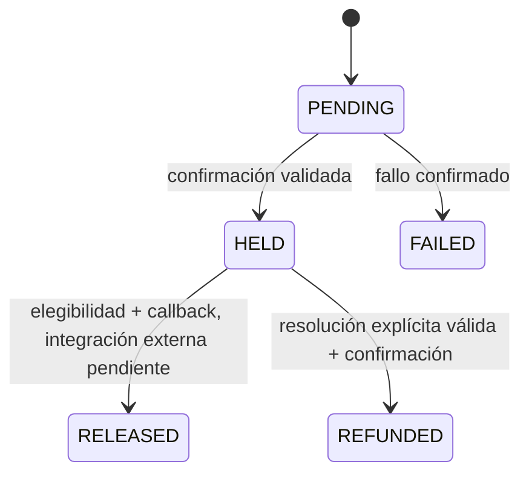

# 05 — Payment, Checkout Pro, recuperación y Kafka

[Índice](README.md) · [Contratos HTTP](06-api-contracts.md)

## 1. Dos componentes, una máquina de estados local

El módulo Payment de Spring posee las operaciones persistidas y las reglas financieras ligadas al request/acuerdo. El servicio Go encapsula Mercado Pago y entrega evidencia validada. No hay un segundo Payment store paralelo en Go.

La integración actual es **Checkout Pro / Preferences API**. La preference prepara el checkout; el provider payment representa el cobro concreto. Son recursos distintos del `Payment` interno.

| Identificador | Papel |
|---|---|
| `serviceRequestId` | Trabajo contratado |
| `agreementId` | Snapshot aceptado que determina el importe |
| `paymentId` | Identidad local de la operación financiera |
| `providerPreferenceId` | Recurso de configuración del checkout |
| `providerPaymentId` | Cobro concreto confirmado/consultado en Mercado Pago |
| `external_reference` | Texto del ID de Payment local para correlación |

Una misma preference puede tener intentos externos distintos. Por eso la presencia de un checkout URL y `PENDING` local no basta para autorizar otro intento.

## 2. Crear checkout sin confiar en el body del navegador

El endpoint público recibe `serviceRequestId`; Spring valida:

1. Request existente y perteneciente al cliente autenticado.
2. Estado `MATCHED` o compatibilidad `IN_PROGRESS`.
3. Agreement existente, quote `ACCEPTED` y participantes correspondientes.
4. Worker actualmente verificado.
5. Importe local igual al total del agreement.
6. Ausencia de múltiples operaciones locales activas conflictivas.
7. Evidencia de intentos anteriores: una aprobación tardía no debe eludirse creando otro Payment ID.

La comisión actual es 9 %, con precisión decimal y redondeo a dos posiciones. No se recibe desde el navegador.

Spring reserva `PENDING` bajo lock y registra `checkoutRequestedAt`. Habla con Go fuera de esa transacción, con `X-Internal-Secret` y `X-Idempotency-Key` derivados del ID local. Después persiste preference y URL bajo lock y valida que el recurso externo no haya cambiado.

Ante configuración ausente conocida se permite reintentar la misma operación. Ante timeout ambiguo se conserva PENDING/identidad y se limita el reintento inmediato. No se asume que un timeout haya evitado crear la preference.

## 3. Preference que construye Go

El adaptador usa un item con cantidad uno, moneda ARS y total del acuerdo. `external_reference` es Payment ID; `notification_url` procede de configuración, y las tres `back_urls` apuntan a `FRONTEND_URL + /payments`.

| Campo | Fuente |
|---|---|
| item title | Descripción de contratación enviada por Spring |
| quantity | 1 |
| currency_id | ARS |
| unit_price | Importe validado por Spring |
| external_reference | Payment ID convertido a texto |
| notification_url | MP_WEBHOOK_URL |
| back_urls.success / failure / pending | FRONTEND_URL + `/payments` |

La configuración rechaza retorno localhost, IP local/privada y el mismo hostname usado para el webhook. Los orígenes deben ser HTTPS públicos. No se hardcodean dominios temporales de túnel.

El código consume `init_point` devuelto por el proveedor. No se decide si una operación usa dinero TEST únicamente porque una URL tenga determinado nombre: hay que validar cuenta/aplicación/credenciales y evidencia externa. Esta documentación sólo registra el checkout TEST observado, sin habilitar producción.

Antes de crear una preference, Go inspecciona pagos de la referencia y busca una existente. La recuperación exige resultado único y valida item/importe/moneda/cantidad/descripción y webhook, en lugar de crear otra silenciosamente.

**Límite actual de recovery:** no todos los campos de retorno de una preference recuperada se vuelven a comprobar en ese método. Si cambió la infraestructura, validar las back_urls almacenadas sigue siendo necesario; los tests de generación nueva no prueban todos los recursos históricos.

## 4. Retorno del navegador no confirma el cobro

Mercado Pago puede regresar a `/payments` con query de status y IDs. Esa URL es navegación, no prueba de autenticidad ni fuente final del estado. Angular vuelve a consultar Spring y puede iniciar sincronización explícita del Payment pendiente según el flujo disponible.

Un usuario puede recargar, volver por historial o editar query. Ninguna de esas acciones debe fabricar HELD por sí misma. La confirmación requiere provider lookup y validaciones del lado servidor.

## 5. Webhook: firma primero, proveedor después

El webhook público es `POST /webhooks/mercadopago`, servido por Go. La implementación limita el body, lee tipo/ID y verifica firma antes de consultar o publicar información financiera.

Manifest actual:

```text
id:<resource-id>;request-id:<x-request-id>;ts:<ts>;
```

Se calcula HMAC-SHA256 con la Secret Key de Webhooks y se compara con `v1` decodificado mediante comparación constante. El parser rechaza componentes duplicados/inválidos, exige request ID y timestamp positivo. El ID se restringe al flujo numérico de pagos y debe coincidir entre body y query `data.id`.

La implementación no debe describirse como compatible con cualquier tópico/recurso alfanumérico: procesa pagos numéricos. La interoperabilidad de todos los casos de headers y la validación de entregas reales siguen pendientes de demostración integral.

Con firma válida, Go consulta el pago real. Verifica identidad, `external_reference`, importe positivo/decimal y ARS. Para aprobación, utiliza además las verificaciones completas de binding/duplicados. Traduce el resultado confirmado y lo transporta a Spring.

| Estado externo | Traducción inicial | Condiciones posteriores |
|---|---|---|
| approved | HELD | Aprobación/acreditación y binding validados |
| rejected / cancelled | FAILED | Máquina local debe admitir transición |
| refunded | REFUNDED | Spring exige resolución de devolución válida |
| pending / in_process / otros no mapeados | Sin transición financiera final | No se convierte en HELD |

Una firma válida no elimina las validaciones de importe/identidad. Un estado externo desconocido no habilita una transición inventada.

## 6. Acknowledgement y modo diagnóstico

Go responde 200 luego de que el transporte confirme el envío del evento, o cuando un tópico válido no requiere transición. Un fallo de firma responde 401; configuración de secret ausente o procesamiento/transporte no disponible producen error sin completar artificialmente el pago.

Existe un modo de diagnóstico explícito `FIXY_WEBHOOK_DIAGNOSTIC_ONLY`. En ese modo se verifica firma y responde sin provider lookup/publicación. Un 200 en esa configuración prueba únicamente el checkpoint de autenticación del POST. **Debe quedar deshabilitado para comprobar el flujo financiero real.**

Una simulación del panel de Mercado Pago se documenta como `SIMULATED`; no transforma el pago real ni reemplaza un webhook REAL. Tampoco demuestra qué headers llegó a tener una entrega histórica fallida.

## 7. Inspección read-only del proveedor

El método de inspección busca por `external_reference` y recorre páginas. Para cada resultado consulta el recurso y comprueba collector de la cuenta del token, ID, referencia, importe, moneda y asociación con merchant order/preference cuando hay preference conocida.

La inspección no crea preference, no cobra, no cambia DB ni publica eventos.

| Resultado de inspección | Interpretación |
|---|---|
| NEVER_PAID | No se encontró provider payment bajo la búsqueda validada |
| PROCESSING | Hay un intento pendiente/in_process/authorized |
| APPROVED | Una aprobación accredited inequívoca |
| RETRYABLE | Intentos rechazados/cancelados, sin aprobación/procesamiento |
| Error / anomalía | Evidencia incompleta, inconsistente o múltiples operaciones peligrosas |

Se bloquea si hay múltiples aprobaciones, múltiples operaciones en procesamiento o aprobación más procesamiento. Una búsqueda incompleta o resultado desconocido falla de forma cerrada. El sistema no selecciona “el último” como si eso demostrara el cobro correcto.

## 8. Reconciliación legítima

La reconciliación pública exige CLIENT propietario. Puede recibir provider ID explícito; la sincronización identifica la aprobación mediante inspección. Ambas convergen en un lookup validado y la transición de dominio existente.

Go comprueba pago aprobado/acreditado, referencia, ARS, total, collector, preference, item y pertenencia a merchant order. También exige que la inspección encuentre una única aprobación correspondiente.

Spring valida la respuesta, abre otra transacción y vuelve a comprobar ownership, amount, preference y agreement bajo locks. Si cambió el snapshot mientras esperaba al proveedor, rechaza. Si todo coincide aplica HELD de forma idempotente, registra el origen de reconciliación y no crea earning.



No equivale a reproducir un webhook. La evidencia E2E debe separar “cobro real + reconciliación” de “cobro real + notificación firmada real”.

## 9. Duplicados y anomalías

Protecciones actuales:

- Una operación local duradera por intento de checkout activo.
- Lease para no crear paralelamente otra llamada tras un intento reciente ambiguo.
- Idempotency key estable vinculada al ID interno.
- Recuperación de preference única en lugar de creación ciega.
- Inspección antes de devolver un link guardado aunque el estado local sea PENDING.
- Bloqueo ante aprobación/procesamiento previo, incluso si el estado local histórico era FAILED.
- Constraints únicos para provider preference/payment IDs.
- Transición repetida al mismo estado válida como no-op; identidades conflictivas se rechazan.
- `409 MULTIPLE_PROVIDER_PAYMENTS` para operaciones ambiguas, sin seleccionar un cobro ni crear earning.

Estas protecciones no garantizan que Mercado Pago nunca permita varios intentos desde una URL ya abierta. Detectar/anotar una anomalía y definir su tratamiento financiero excepcional siguen siendo responsabilidades separadas. No hay limpieza automática ni refund administrativo implementado para elegir entre múltiples cobros.

## 10. Transporte Kafka opcional

Con `FIXY_PAYMENT_KAFKA_ENABLED=true`, Go usa publisher Kafka. Sin ese flag, el `EventSink` es cliente HTTP del backend.

Envelope actual:

| Campo | Propósito |
|---|---|
| schemaVersion | 1 |
| eventId | SHA-256 determinista de Payment ID, provider ID y estado |
| type | `payment.status-confirmed` |
| occurredAt | Timestamp UTC de emisión |
| data | Payment ID, provider ID, status e importe |
| Kafka key | Payment ID, conserva afinidad por operación |

Producer síncrono, `acks=all`, retries limitados, timeout y sin autocreación de topics desde Go. Spring declara topic `fixy.payment.events.v1` y `.DLT`, tres partitions y una réplica en la configuración actual; esa réplica es una configuración de desarrollo, no alta disponibilidad productiva.

El consumer usa commit por record y auto-commit deshabilitado. Valida envelope y key, invoca el service transaccional y sólo confirma después de que retorna. Los errores transitorios tienen backoff/retries; errores malformados o 4xx de dominio se clasifican no reintentables y llegan al DLT. La publicación DLT espera resultado del broker.

No hay outbox/inbox durable ni deduplicación por tabla de `eventId`. La máquina de estados y constraints protegen reentrega; no se declara exactly-once financiero. La supervisión/reproceso autorizado del DLT, ACLs y pruebas de caída de broker son pendientes operativos.

## 11. Protección, release y earning

Estados locales actuales: `PENDING`, `HELD`, `RELEASED`, `FAILED`, `REFUNDED`.



La elegibilidad de release exige request COMPLETED, protección vencida, fondos HELD y dispute no bloqueante. El plazo se calcula desde `completedAt`; default central P3D, snapshot en acuerdo/pago.

El scheduler consulta candidatos paginados, tiene intervalo configurable y evita repetir solicitudes recientes de release. Sólo un callback válido a RELEASED crea `WorkerEarning AVAILABLE`, por neto y worker contratado, si no existe previamente.

**Bloqueo real de implementación:** Go `ReleasePayment` retorna `ErrSettlementUnavailable`, y el handler responde 501. El scheduler no debe convertir esa respuesta en RELEASED. Por tanto no se afirma liquidación automática real lista.

El nombre `settledAt` del DTO corresponde al timestamp `releasedAt` del modelo, y el timeline usa `PAYMENT_SETTLED`. El enum persistido sigue siendo RELEASED, no SETTLED.

## 12. Disputes, refunds, OAuth y payout

Una dispute activa impide release. Un callback REFUNDED necesita resolución explícita full-refund/client-favor; partial/post-settlement no está soportado. Resolver una dispute no dispara automáticamente una devolución externa.

Hay infraestructura OAuth para conectar cuentas y modelos de payout/earnings. El checkout inspeccionado usa token de la cuenta principal, no necesita OAuth de cada worker para crear la preference.

El adaptador de payout conserva un endpoint de proveedor histórico/provisional que requiere rediseño/validación de producto contratado. No se ejecutó payout real, no se habilitó Split y no se presenta ese código como solución de desembolso productivo.

## 13. Configuración, sólo nombres

| Variable / propiedad | Consumidor | Función |
|---|---|---|
| MP_ACCESS_TOKEN | Go | API del proveedor; no publicarlo en Angular |
| MP_WEBHOOK_SECRET | Go | Verificar firma, independiente del Access Token |
| MP_WEBHOOK_URL | Go | URL HTTPS de Go + ruta webhook |
| FRONTEND_URL | Go | Origen/base HTTPS para retorno a `/payments` |
| INTERNAL_API_SECRET | Spring y Go | HTTP interno autenticado |
| BACKEND_URL | Go | Base Spring; fallback histórico KOTLIN_BACKEND_URL |
| PORT | Go | Puerto del listener |
| MP_CLIENT_ID / MP_CLIENT_SECRET / MP_REDIRECT_URI | Go OAuth | Sólo flujo de cuenta vinculada |
| FIXY_PAYMENT_KAFKA_ENABLED | Go y Spring | Elegir transporte; flags deben concordar |
| KAFKA_BOOTSTRAP_SERVERS | Go y Spring | Brokers |
| FIXY_PAYMENT_KAFKA_TOPIC | Go | Topic del publisher |
| fixy.payment.kafka.topic / group | Spring | Topic y consumer group |
| fixy.payment.gateway-url | Spring | Base del adaptador Go |
| fixy.payment.protection-period | Spring | Default de protección |
| fixy.payment.automatic-settlement-enabled / settlement-interval-ms | Spring | Scheduler |
| FIXY_WEBHOOK_DIAGNOSTIC_ONLY / FIXY_WEBHOOK_DIAGNOSTIC_PAYMENT_ID | Go | Ventana diagnóstica; no evidencia financiera por sí sola |

El topic configurado en Go debe coincidir con la propiedad de Spring; no se presupone que ambos nombres se mapeen automáticamente igual. Los secretos se inyectan localmente/por plataforma de despliegue, sin `.env` público. Este repo no incluye valores ni autoriza ejecutar operaciones monetarias.
