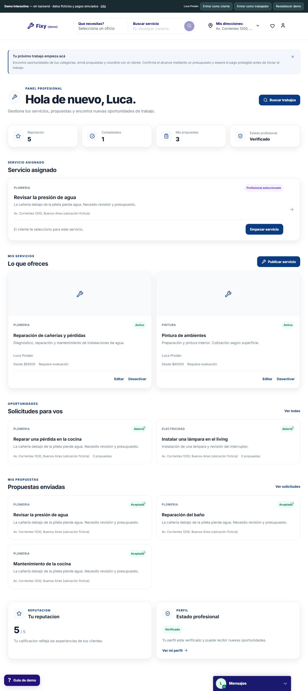
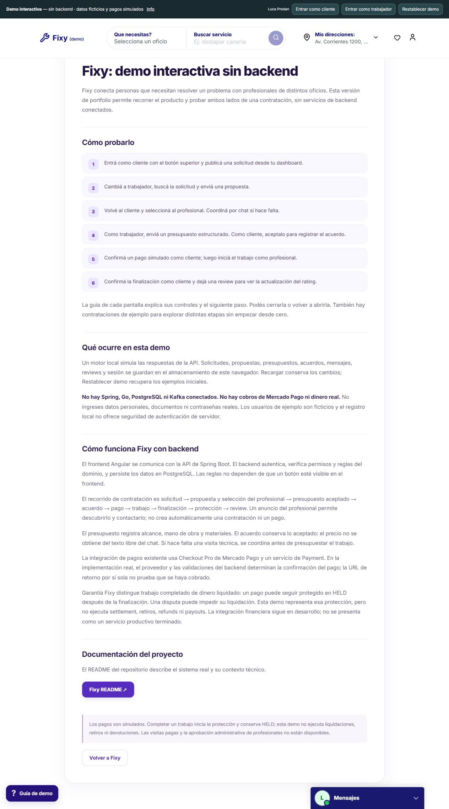

# 09 — Recorrido visual: capturas reales

[Índice](README.md) · [Abrir demo](https://youngnicojava.github.io/fixy-demo-frontend/)

Todas las imágenes de esta galería se obtuvieron navegando la demo pública el **10/10/2026**. Son screenshots del producto renderizado, no mockups generados ni interfaces reconstruidas para ilustrar la documentación.

Los nombres, ubicaciones, importes e IDs visibles pertenecen a fixtures ficticios de la demo. No representan el usuario ni los pagos históricos de las pruebas privadas. La barra “Demo interactiva — sin backend” se conserva deliberadamente en las capturas.

## 1. Portada y descubrimiento

[Explorar esta pantalla](https://youngnicojava.github.io/fixy-demo-frontend/#/home)

Demuestra identidad visual, navbar con marca demo, búsqueda por oficio y acceso a mensajes/guía. El carousel es contenido visual del frontend; no es evidencia de geolocalización ni consultas al backend.

## 2. Solicitud y acuerdo

[Explorar contratación de ejemplo](https://youngnicojava.github.io/fixy-demo-frontend/#/requests/103)

El detalle concentra la necesidad del cliente y el contexto de contratación. El agreement expresa importe y alcance; el CTA de pago puede encontrarse sin abrir chat. El presupuesto/acuerdo del screenshot es ficticio y el pago todavía está pendiente en ese fixture.

La captura es de página completa, para conservar profesional, comentarios e historial. No acredita que se haya hecho un cobro real.

## 3. Área Pagos

[Explorar Pagos](https://youngnicojava.github.io/fixy-demo-frontend/#/payments)

Cada trabajo tiene operación independiente. El listado muestra título, profesional, total y enlace a contratación. No es carrito ni checkout agregado. La disponibilidad de las secciones no prueba que se haya ejecutado settlement/refund; algunos estados proceden de fixtures.

## 4. Conversación y contexto comercial

[Explorar conversaciones](https://youngnicojava.github.io/fixy-demo-frontend/#/conversations)

El usuario de demo José María Paz ve a Luca Prodan como interlocutor tanto en la lista como en el header. El último sender sigue identificado dentro del mensaje. El contexto comercial muestra el acuerdo sin transformar el chat en contrato.

La lectura de consola de esta vista no mostró errores durante la captura. No se enviaron mensajes reales ni se conectó un WebSocket.

## 5. Dashboard profesional

[Explorar dashboard como worker](https://youngnicojava.github.io/fixy-demo-frontend/#/dashboard/worker)

Demuestra la otra perspectiva: estado profesional, trabajo seleccionado, publicaciones, oportunidades, propuestas y rating. El acceso rápido de la barra permite adoptar el rol ficticio correcto antes de explorar la ruta.

Se captura una pantalla real de worker, no una UI administrativa inventada. El rating y trabajo completado del fixture no son una ejecución nueva de E2E.

## 6. Info y límites de la demo

[Leer información de la demo](https://youngnicojava.github.io/fixy-demo-frontend/#/demo-info)

La aplicación explica qué se simula, dónde viven los datos, cómo sería el flujo conectado y qué operaciones financieras siguen en desarrollo. Enlaza al README técnico de este repositorio.

## 7. Evidencia backend: alcance de esta publicación

Se inspeccionaron controllers, services, entidades, DTOs, configuración y tests del backend privado y Go. Las explicaciones y diagramas técnicos derivan de ese código, y la matriz E2E resume reportes guardados.

**No se incluye screenshot de Swagger:** Spring no respondió durante esta revisión. Tampoco se dibujó una captura falsa, se levantó otra base vacía ni se ejecutaron comandos financieros para obtener una imagen.

Cuando el backend de desarrollo esté activo, la próxima captura auténtica puede mostrar grupos de endpoints y esquemas en `/swagger-ui/index.html`, sin autorizar credenciales en la imagen, sin ejecutar POST monetarios y sin respuestas personales. Esa evidencia deberá identificarse como nueva captura backend, separada de la galería de demo.

## 8. Trazabilidad de las imágenes

Los archivos JPEG se guardan en `assets/screenshots`. El [manifest de evidencia pública](evidence-manifest.json) registra origen, ruta, alcance y hashes SHA-256. No publica headers ni datos de sesiones privadas.

La observación visual realizada aquí cubre esas pantallas y contexto, no una auditoría completa de accesibilidad, responsive o backend. [Alcance de validación](08-testing-and-evidence.md).
