# 09 — Recorrido visual: capturas reales

[Índice](README.md) · [Recorrido paso a paso](11-demo-walkthrough.md) · [Abrir demo](https://youngnicojava.github.io/fixy-demo-frontend/)

**27 capturas auténticas del frontend público**, obtenidas en navegador el 10/10/2026. No son mockups generados ni reconstrucciones de interfaces. Los nombres, direcciones, importes e IDs pertenecen a datos ficticios locales. Las imágenes no demuestran operaciones del backend privado ni cobros reales.

## Índice visual

- [Autenticación](#autenticación)
- [Navbar y direcciones](#navbar-y-direcciones)
- [Dashboards](#dashboards)
- [Publicación del profesional](#publicación-del-profesional)
- [Publicación de una solicitud](#publicación-de-una-solicitud)
- [Propuesta y selección](#propuesta-y-selección)
- [Presupuesto y acuerdo](#presupuesto-y-acuerdo)
- [Pago protegido e inicio](#pago-protegido-e-inicio)
- [Completion y review: fixture](#completion-y-review-fixture)
- [Pagos, chat e información](#pagos-chat-e-información)

Las etapas de solicitud nueva hasta inicio corresponden al mismo caso: **Demo portfolio · Reparar pérdida de agua**. Completion y review se muestran desde un fixture independiente y están identificadas como tales. Los IDs de esa sesión no pueden compartirse como una contratación pública; cada visitante tiene su almacenamiento local.

## Autenticación

### Formulario de login

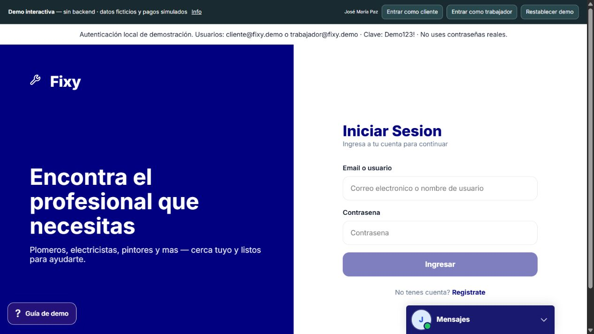

Formulario real con aviso de autenticación local. No representa login contra Spring ni prueba de JWT/refresh.

### Login con usuario ficticio

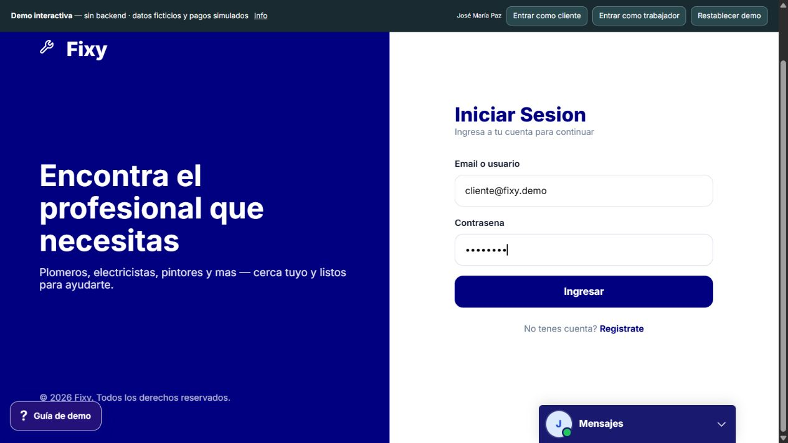

Campos completados con las credenciales públicas de la demo. No se introdujeron credenciales de una cuenta real.

### Registro de cuenta

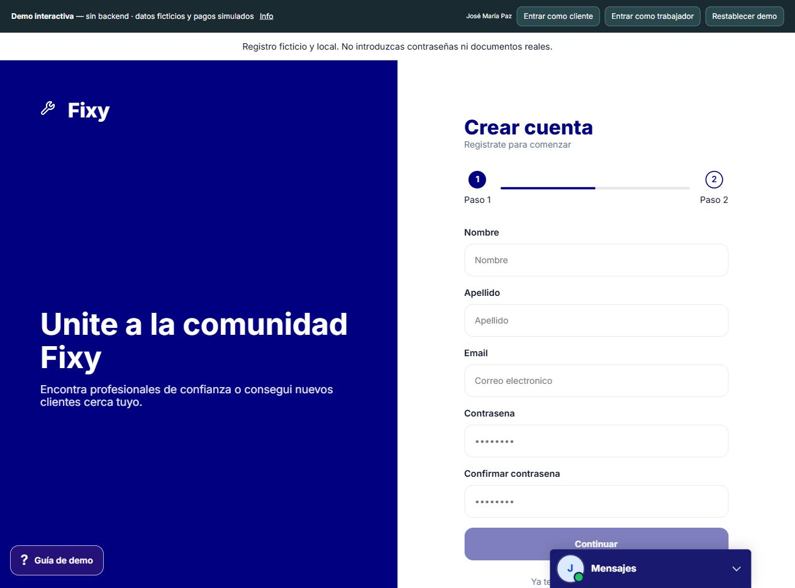

Paso inicial con nombre, apellido, email y contraseña. No se creó una nueva cuenta ni se aceptaron términos para obtener esta imagen.

## Navbar y direcciones

### Portada y navegación

Marca Fixy (demo), búsqueda por oficio y acceso a profesionales. El buscador del navbar aparece deshabilitado; esta imagen no demuestra búsquedas al backend.

### Menú de cuenta abierto

Identidad del usuario y accesos a Panel, Mis solicitudes, Pagos y Panel profesional. Se utilizó Panel para navegar al dashboard cliente.

### Selector de direcciones desplegado

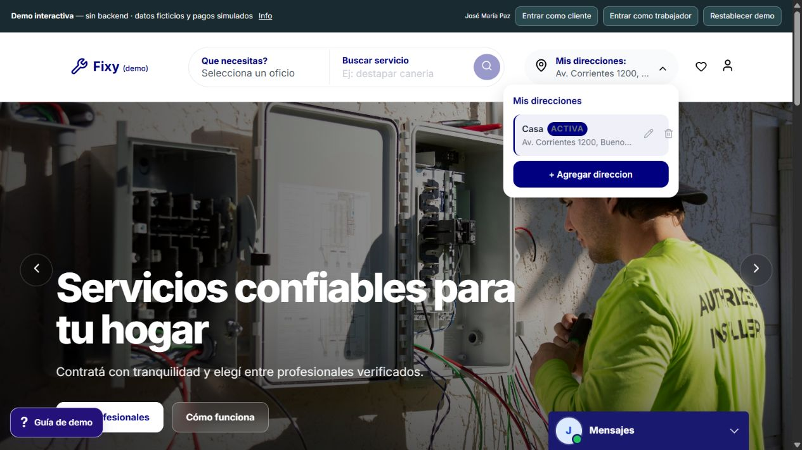

Dirección activa ficticia y acciones editar, eliminar y agregar. No se borraron ni modificaron direcciones.

### Modal de dirección

Casa/Trabajo/Otro, dirección, piso y departamento. La ubicación de demostración reemplaza el mapa externo: no se presenta como evidencia de HERE/Leaflet activo.

## Dashboards

### Dashboard del cliente

Resumen de actividad, solicitudes, profesional seleccionado y accesos a publicar. Permite distinguir solicitudes abiertas, seleccionadas y en progreso.

### Dashboard profesional

Verificación, oportunidades, servicios, propuestas y actividad de Luca Prodan. Rating y trabajos completados provienen de fixtures.

## Publicación del profesional

### Detalle del servicio publicado

Offering con precio desde, descripción, profesional, opiniones y CTA para crear una solicitud. La ausencia real de imágenes se conserva; no se añadió una foto falsa. Una offering no crea un pago automáticamente.

## Publicación de una solicitud

### Crear solicitud

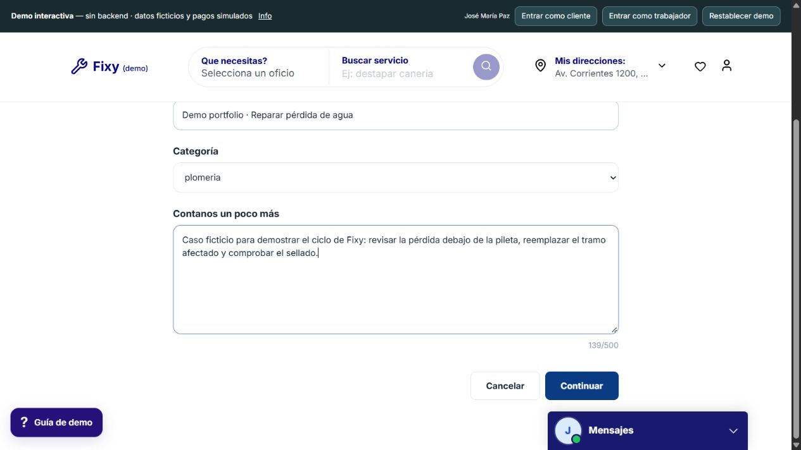

Título, categoría y descripción completados con un caso ficticio. El cliente expresa la necesidad; todavía no existe contrato ni pago.

### Revisión antes de publicar

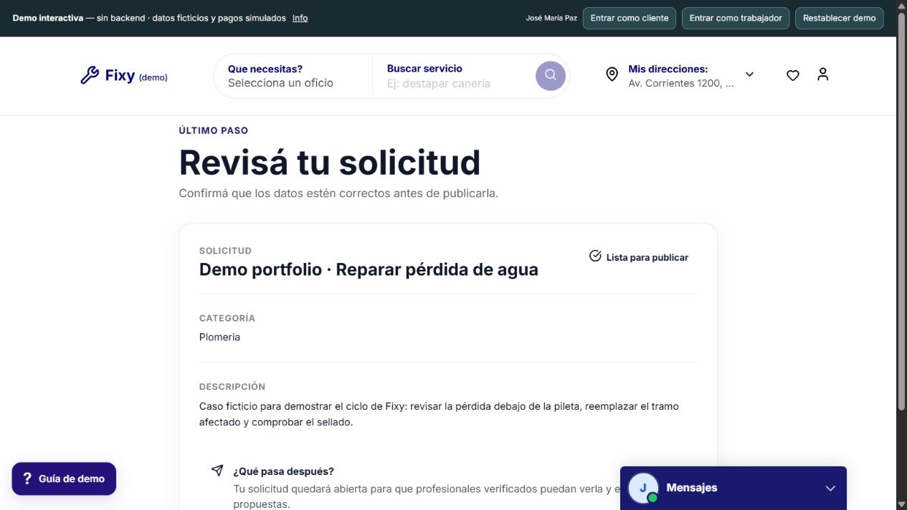

Pantalla publish con el resumen y explicación de qué ocurre después. Se avanzó desde el formulario y se publicó realmente en el estado local de la demo.

### Solicitud publicada: OPEN

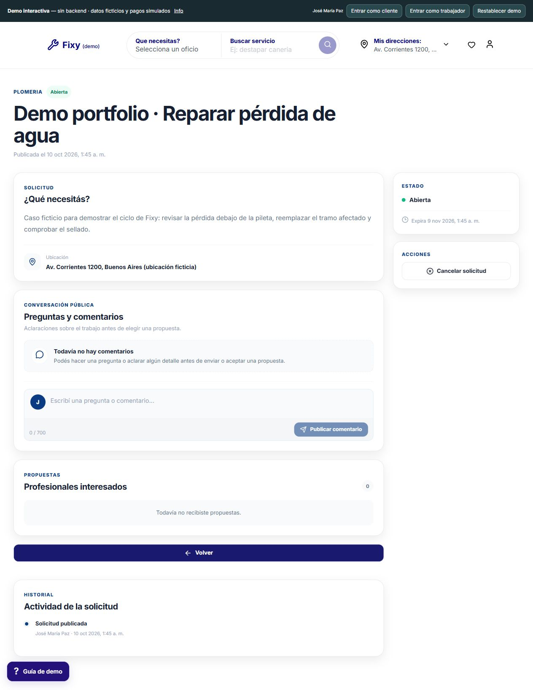

Detalle con necesidad, ubicación ficticia, cero propuestas e historial de publicación. Captura de la nueva solicitud local, no un registro privado.

## Propuesta y selección

### Enviar propuesta como profesional

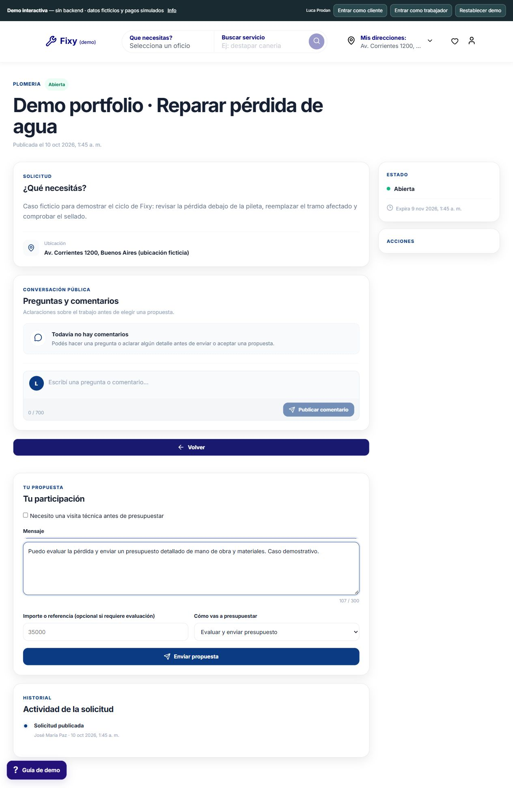

Mensaje y modalidad Evaluar y enviar presupuesto. La elección permite explicar por qué seleccionar al profesional todavía no fija el precio.

### Propuesta recibida: vista cliente

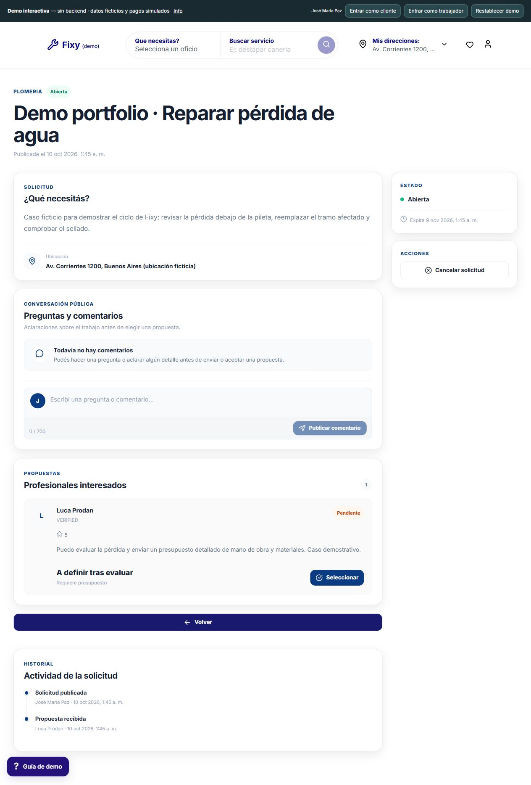

Luca Prodan aparece como profesional interesado, con propuesta pendiente, mensaje y botón Seleccionar. El cliente puede distinguir identidad, oferta y estado.

### Profesional seleccionado: MATCHED

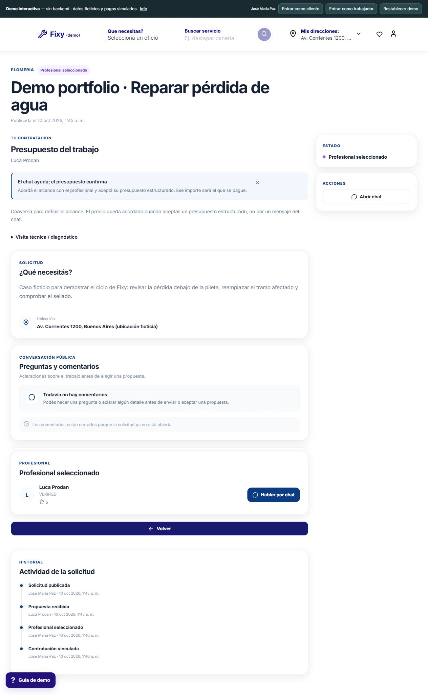

Contexto de contratación y chat disponibles. El aviso explica que el importe debe confirmarse mediante presupuesto estructurado.

## Presupuesto y acuerdo

### Crear presupuesto estructurado

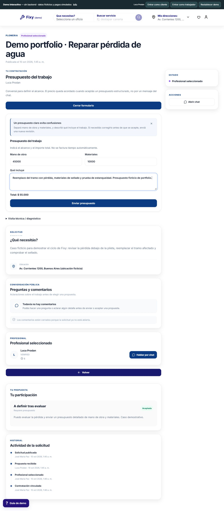

Mano de obra 45.000, materiales 10.000 y alcance detallado; total 55.000 ficticios. La UI diferencia estos datos de un mensaje de chat.

### Presupuesto pendiente de aceptación

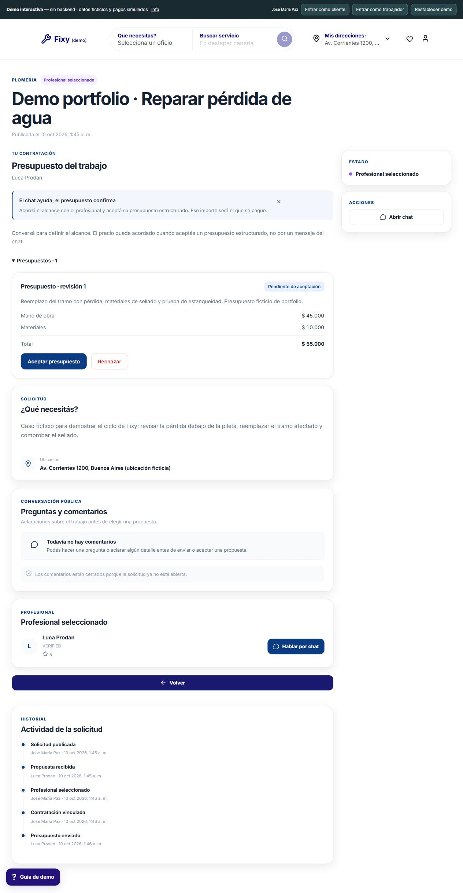

Tarjeta de revisión con desglose y acciones Aceptar presupuesto/Rechazar. La aceptación es una acción explícita del cliente.

### Acuerdo de la nueva contratación

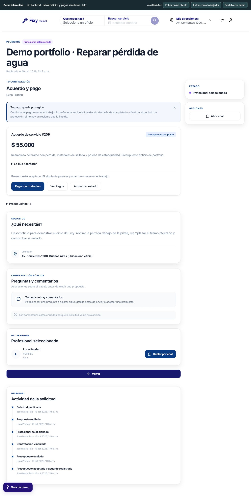

Snapshot de importe y alcance tras aceptar. El CTA Pagar contratación se encuentra en RequestDetail, sin depender del chat.

### Acuerdo del fixture inicial

Vista completa del fixture 103, capturada antes de la nueva solicitud. Mantiene presupuesto, profesional, comentarios e historial. No es otro cobro ejecutado.

## Pago protegido e inicio

### Confirmación de pago simulado

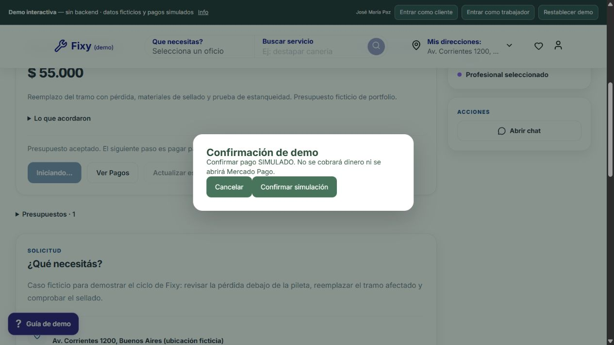

El diálogo informa explícitamente que no cobra dinero ni abre Mercado Pago. Se conserva para evitar confundir la interacción local con Checkout Pro TEST.

### Pago protegido: HELD simulado

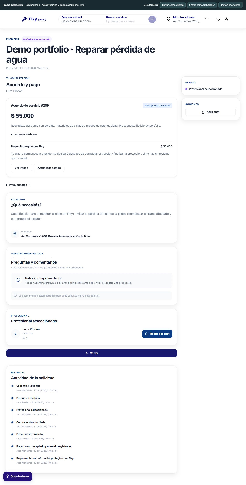

El acuerdo conserva importe y alcance; el estado financiero aparece protegido. No hubo API del proveedor, webhook ni movimiento real de dinero.

### Trabajo iniciado: IN_PROGRESS

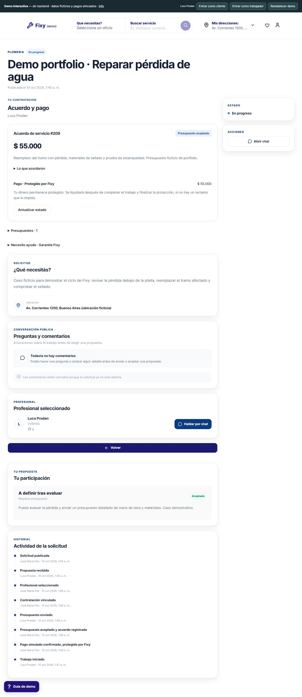

El worker inició mediante la acción disponible y el historial refleja Trabajo iniciado. El pago ficticio permanece protegido; iniciar no equivale a liquidar.

## Completion y review: fixture

### Contratación completada y review precargadas

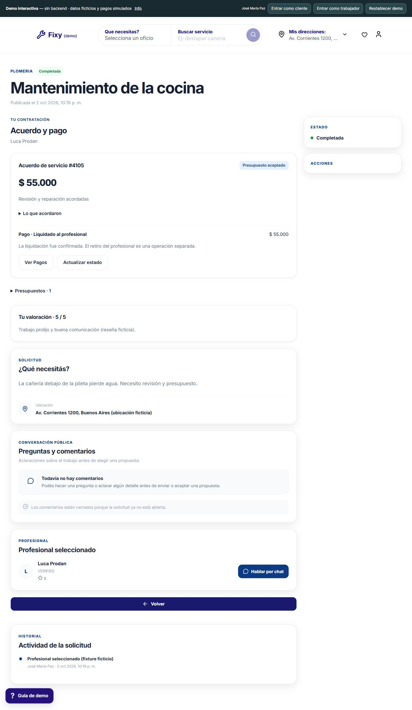

Fixture 105 independiente: estado Completada, review ficticia 5/5 y pago liquidado precargado. La solicitud nueva se capturó hasta IN_PROGRESS; el diálogo nativo de completion bloqueó la automatización. Esta imagen NO certifica completion/settlement/review nuevos.

## Pagos, chat e información

### Área Pagos

Listado por contratación con profesional, importe y acciones. Captura de los fixtures iniciales; no es checkout agregado ni prueba de liquidación.

### Conversación y contexto comercial

José María Paz ve a Luca Prodan en lista y header; sender del mensaje e interlocutor son conceptos distintos. El acuerdo persiste como contexto comercial. No se enviaron mensajes reales.

### Información y límites

Explica datos locales, operaciones simuladas, cómo se conectaría el sistema y enlace a documentación técnica.

## Evidencia backend y trazabilidad

Se inspeccionó el código privado para redactar los documentos técnicos. **No se incluye captura de Swagger:** Spring no respondió durante esa revisión, y no se generó una pantalla falsa ni se levantó una base vacía para ilustrarlo.

Los JPEG están en `assets/screenshots`. El [manifest](evidence-manifest.json) registra ruta, tipo de evidencia y hash SHA-256. La nueva secuencia es `DEMO_SIMULATED`, separada de `PRESEEDED_DEMO_FIXTURE` y de las pruebas financieras privadas históricas. La galería no convierte un fixture en un E2E real aprobado.

[Cómo recorrer las pantallas](11-demo-walkthrough.md) · [Alcance de pruebas](08-testing-and-evidence.md)
